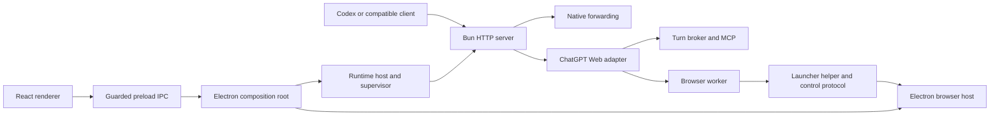

# NEKODEX architecture

This is the maintained architecture of this checkout. Use it with the
[feature extension guide](docs/development/extending-nekodex.md) and generated
[module/dependency map](docs/development/module-map.json). Historical review
reports describe their revisions; they do not override current source. Detailed
[mode and operational contracts](docs/architecture.md) remain a companion reference.

## Product and runtime boundaries

NEKODEX combines a Bun service implementing a Responses-compatible bridge with
an Electron desktop application for accounts, browser turns, tools and runtime
supervision. React renders the launcher UI. Native provider forwarding, automatic
ChatGPT browser execution and Manual handoff are distinct transports.

These arrows describe communication and authority, not permission to import an
orchestration module into every dependency. Browser selection, account identity,
connector readiness, runtime readiness and installed release identity are
separate facts.

## Entry points and responsibilities

| Area | Entry points / owners | Boundary |
| --- | --- | --- |
| CLI and service | [cli.ts](src/cli.ts), [argument helpers](src/lib/cli-args.ts), [service.ts](src/service.ts), [LaunchAgent helpers](src/launch-agent.ts), [server.ts](src/server.ts) | Configuration selects host/port; server admission, local-request checks and stream settlement protect the HTTP boundary. Default configuration uses port 17841. The daemon and tunnel services share LaunchAgent path, launchd domain and status-probe helpers; each keeps its own label, plist template and timeouts. |
| Request parsing | [Responses parser](src/responses/parser.ts), [schema](src/responses/schema.ts), [HTTP body](src/http-body.ts) | Validate input before dispatch; optional reasoning summary/content/encrypted content accept Desktop replay nulls as absence, while populated values retain strict validation. Native forwarding retains the original request bytes; transformed bytes require matching headers. |
| Response translation | [SSE bridge](src/bridge.ts), [JSON projection](src/responses/json-output.ts), [shared output policy](src/responses/output-policy.ts) | Stream cancellation/backpressure stay with SSE; both forms use the same usage/error/tool conventions. Unknown usage is not zero. |
| Continuations | [continuation scope](src/responses/continuation-scope.ts), [owner derivation](src/responses/continuation-owner.ts), [state](src/responses/state.ts), [snapshot codec](src/responses/state-snapshot.ts) | Scope derivation has no disk side effects. Live retention/persistence and snapshot encoding are separate; response IDs must remain bound to their owner. |
| Native transport | [forwarding](src/native-passthrough.ts), [request preparation](src/native-request-preparation.ts), [network routing](src/native-network.ts), [body delivery](src/native-response-body.ts), [terminal inspector](src/native-terminal-inspector.ts) | Preserve authoritative bytes and cancellation. Telemetry observes outcomes; it cannot change delivery or invent provider usage. |
| Web orchestration | [adapter](src/adapters/chatgpt-web/index.ts), [turn runtime](src/adapters/chatgpt-web/turn-runtime.ts), [execution registry](src/adapters/chatgpt-web/turn-execution.ts), [session](src/adapters/chatgpt-web/turn-session.ts), [tool-result projection](src/adapters/chatgpt-web/broker-tool-result.ts), [rejected tool results](src/adapters/chatgpt-web/rejected-tool-results.ts) | One runtime/registry owns a turn. Reconnection replays journalled events instead of submitting another browser task. Ordinary rounds and active compaction share one Codex tool-result to broker payload projection. A follow-up that fails request validation answers its matched outstanding calls with an explicit error and fails that browser turn. |
| MCP and tools | [MCP server](src/adapters/chatgpt-web/mcp-server.ts), [routing](src/adapters/chatgpt-web/mcp-tool-routing.ts), [broker](src/adapters/chatgpt-web/turn-broker.ts), [owned operations](src/adapters/chatgpt-web/turn-broker-owned-operations.ts), [broker event log](src/adapters/chatgpt-web/turn-broker-diagnostics.ts) | Schema discovery is not authorization. Bind invocation and result acknowledgement to exact turn/operation identities; keep replay guards. A never-dispatched call with no Codex consumer for 25 s is cancelled, not retained. The background daemon writes broker lifecycle events (identifiers and counts only) to `diagnostics/turn-broker-events.jsonl`; the MCP process releases its leases on SIGTERM/SIGINT/stdin close. |
| Environment authority | [environment](src/adapters/chatgpt-web/environment.ts), [envelope syntax](src/adapters/chatgpt-web/environment-envelope.ts), [resolver](src/adapters/chatgpt-web/thread-environment-resolver.ts) | Parsing an envelope does not establish provenance or grant access to a working directory. |
| Prompt and files | [prompt compiler](src/adapters/chatgpt-web/prompt.ts), [context envelope](src/adapters/chatgpt-web/prompt-context-envelope.ts), [multipart contract](src/adapters/chatgpt-web/prompt-multipart-contract.ts), [input policy](src/adapters/chatgpt-web/browser-input-policy.ts), [attachments](src/adapters/chatgpt-web/attachment-payloads.ts), [file content](src/responses/file-content.ts) | Keep request validation, authorized bytes, transport formatting and account capacity independent. Multipart acknowledgements and commit identify one transaction. |
| Browser automation | [worker](src/adapters/chatgpt-web/browser-worker.ts), [model selection](src/adapters/chatgpt-web/browser-model-selection.ts), [page guards](src/adapters/chatgpt-web/browser-page-guards.ts), [stage budget](src/adapters/chatgpt-web/browser-stage-budget.ts), [submission policy](src/adapters/chatgpt-web/browser-submission-policy.ts), [submission DOM](src/adapters/chatgpt-web/browser-submission-dom.ts), [response DOM](src/adapters/chatgpt-web/browser-response-dom.ts) | Worker owns acquisition/send/rebind/settlement and chooses each stage and its budget. Page guards classify blocking dialogs/alerts without owning the page; the stage budget owns timeout and sleep-refund mechanics; submission policy is pure evidence/turn-identity logic the worker consults. DOM readers return observations; a proven detached response permits the worker to rebind only to the unique accepted replacement, while evaluation faults on present nodes remain errors. Cached evidence stays tied to the document/turn. |
| Progress and diagnostics | [response policy](src/adapters/chatgpt-web/browser-response-policy.ts), [visible trace](src/adapters/chatgpt-web/browser-visible-trace.ts), [diagnostics](src/adapters/chatgpt-web/browser-diagnostics.ts) | Live external work suspends terminal grace windows, not the task deadline. Diagnostics retain bounded structural evidence; screenshots are opt-in. |
| Compaction | [transaction](src/adapters/chatgpt-web/compaction-transaction.ts), [run registry](src/adapters/chatgpt-web/compaction-run-registry.ts), [active source](src/adapters/chatgpt-web/active-compaction-source.ts), [rolling checkpoint](src/adapters/chatgpt-web/rolling-checkpoint.ts) | Logical cancellation and physical settlement differ. Publish a checkpoint in memory only after its durable write succeeds. |
| Configuration/setup | [config](src/config.ts), [setup](src/setup.ts), [setup policy](src/setup-policy.ts), [file transactions](src/file-transactions.ts), [Codex integration](src/codex-integration.ts) | Bind candidate writes to the original snapshot. `useSavedChats` defaults off, validates as a boolean, and remains independent of fresh-per-turn behavior. Optional `nativeBackgroundRoute` (`DIRECT` or an exact HTTP(S) origin) is written only by `setup --native-background-route`, validated by both config parsers, and reaches the daemon solely as `CODEX_CHATGPT_WEB_NATIVE_BACKGROUND_ROUTE` from the supervisor's `spawnChild`, where an explicit environment value wins; PAC/route-cache evidence never produces it. A committed-write receipt differs from a before-image; rollback cannot overwrite a newer owner's edit. |
| Account tunnels | [binding store](launcher/electron/account-tunnels.cjs), [peer supervisor](launcher/electron/account-tunnel-supervisor.cjs), [account pool](launcher/electron/account-pool.cjs), [runtime host](launcher/electron/runtime.cjs) | `accountTunnelMode` enables strict one-account/one-mode ownership. `accountTunnels` holds distinct cloud IDs, aliases, profiles and scoped protected references (or explicit legacy key paths). A captured config generation and immutable credential are prepared before only the affected peer stops; commit checks the captured config bytes and link target. Peer startup creates the private profile before inventory; healthy peer monitoring describes transport readiness while the production parent owns broker admission. Missing/unready bindings never borrow another account's tunnel. New or explicitly reconfigured bindings derive SDK-global aliases from the canonical application home, account and mode so DEV and production cannot collide; loading a saved binding does not silently rename it. Changed sign-in fingerprints retire readiness. Native forwarding and healthy peers remain independent. A peer records the PID and start identity it verified; while they match, supervision, recovery and Quit use only local signals, never tunnel-client's remote `runtimes status` lookup. A failed first start enters the same backoff recovery, and the parent's Web repair action reconnects failed or backed-off peers. |
| Tunnel | [installation/control](src/tunnel.ts), [status interpretation](src/tunnel-status.ts), [service](src/tunnel-service.ts) with [LaunchAgent helpers](src/launch-agent.ts) | Inventory/diagnostics parsing has no process authority. Scoped stopped proof requires successful inspection, an explicitly non-running process and stopped state; the SDK's missing/null/empty error values mean no status error. Installation, credentials and readiness remain separate steps. |
| Electron composition | [main](launcher/electron/main.cjs), [preload](launcher/electron/preload.cjs), [IPC registrars](launcher/electron/ipc), [control server](launcher/electron/control-server.cjs) | Main owns guarded IPC and composition. Renderer inputs and helper calls cross validation/admission boundaries. |
| Native plan content | [source observer](src/adapters/chatgpt-web/task-plan-observation.ts), [capture policy](src/adapters/chatgpt-web/task-plan-policy.ts), [wire validator](launcher/electron/task-plan-observation.cjs), [store](launcher/electron/task-plans.cjs), [requirements](launcher/electron/task-plan-requirements.cjs), [TaskPlans](launcher/src/TaskPlans.tsx) | Separate opt-in content store, never the metadata ledger. `/v1/turn/plan` validates the exact live trace/helper/surface/task and recorded native thread/turn before capture; observed plan claims remain unverified. Explicit requirements/corrections and CAS-bound associations retain trusted action metadata separately from personal user confirmation; property verification is unavailable here. |
| Conversation text history | [store](src/conversation-history/store.ts), [HTTP actions](src/conversation-history/http.ts), [validated producer adapter](src/conversation-history/capture.ts), [canonical capture](src/conversation-history/canonical.ts), [owned Native final projection](src/conversation-history/owned-native.ts), [main recorder](launcher/electron/canonical-native-history.cjs), [filter](launcher/electron/canonical-history-policy.cjs), [IPC](launcher/electron/ipc/conversation-history.cjs), [surface](launcher/src/ConversationHistorySurface.tsx) | The Bun daemon owns the SQLite/FTS writer. Manual selected text, explicitly refreshed native canonical pages and future validated owned Native final summaries have separate default-off policies. Owned final capture requires global recording, exact task-generation consent, risk acknowledgement and a pre-offer lease; trusted admission provenance and current task authority are revalidated at write. Source-unavailable revocation persists across source return; unavailable status never asserts consent is off. Per-thread consent/recording epoch invalidates late capture; known-pattern exclusions do not guarantee removal of unknown secrets. All corpus coverage remains partial; native empty-page proof is not text proof. |
| Local project workspace | [service](launcher/electron/local-workspace.cjs), [IPC](launcher/electron/ipc/workspace.cjs), [surface](launcher/src/WorkspaceSurface.tsx) | Main's native picker grants an opaque root ID; renderer paths stay relative. The service owns private persisted roots/drafts, bounded reads and revision-aware writes. Opaque captured base choices support HEAD/local/remote-tracking comparisons with stale reference checks, no fetch/checkout. Actual DEV UI showed HEAD and older-base working diffs/full OIDs without moving main. Bounded in-memory comparisons remain read-only, not recoverable code checkpoints. |
| Native Codex thread control | [client](launcher/electron/codex-client-control.cjs), [IPC](launcher/electron/ipc/codex-client-control.cjs), [surface](launcher/src/NativeThreadsSurface.tsx), [projection](launcher/src/native-threads-model.ts) | Public native thread list/read UI remains metadata-only; the main-only canonical recorder separately reads supported items under explicit consent. Status is scoped to the configured connection/server. Fork is an explicit user action; start/interrupt/approve are unsupported. Executable/home/socket are main-owned dependencies. |
| Retained owned Native conversations | [owner](launcher/electron/persistent-native-conversations.cjs), [IPC](launcher/electron/ipc/native-persistent-conversations.cjs), [panel](launcher/src/NativePersistentConversationsPanel.tsx), [contract](docs/design/persistent-native-conversations.md) | Explicit retention, follow-up, fork, idle-close and explicit Resume share the qualified account's sender and lease. Resume validates stored account identity and creates a new binding/admission for the same thread; it does not send a turn. Reads and restart never auto-resume. Legacy records lacking identity proof and third-party client handoff remain unavailable. |
| Native owner recovery | [transaction](launcher/electron/native-account-recovery.cjs), [macOS observer](launcher/electron/native-recovery-processes.cjs), [contract](docs/design/native-owner-recovery.md) | Explicit preview and separately confirmed stable plan archive only verified stale ownership markers after physical process absence. Passive exact receipt reconciliation never replays a prior effect; partial archives retain uncertainty and ownership. Account authentication, model requests and original journals remain separate. |
| Owned Native inference leaf | [admission](launcher/electron/owned-native-admission.cjs), [worker](launcher/electron/owned-native-worker.cjs), [receipts](launcher/electron/owned-native-journal.cjs) | The trusted [auth authority](launcher/electron/native-account-authority.cjs) owns explicit fresh-profile official CLI device login; the [inventory owner](launcher/electron/native-account-inventory.cjs) qualifies only its own exact personal-Pro-family profile (`pro`, `prolite`, `promax`), native account/usage and original catalog; the actual plan value is retained. The [execution owner](launcher/electron/native-account-execution.cjs) seals qualified model metadata and resolves model/admission pairs into one account stdio process/AuthManager/sender with up to two new isolated task threads. Main/Bun/Agent UI use a private descriptor and fixed protocol. An isolated personal Pro (Max) account and two real models have been admitted and exercised; this does not establish all-account or installed-app acceptance. The pinned public-library Rust wrapper keeps mandatory policy; network-denied `--account-info` classification is separate from cloud-aware startup checks. Fixture-route official-account refusal remains unchanged. Existing metadata/fork authority is unchanged; neither fake-provider evidence nor a compiled wrapper proves real delivery. |
| Standalone Agent mode | [store](src/agent-mode/store.ts), [runner](src/agent-mode/runner.ts), [runtime](src/agent-mode/runtime.ts), [Responses port](src/agent-mode/provider.ts), [Native port](src/agent-mode/native-provider.ts), [main bridge](launcher/electron/agent-native-bridge.cjs), [HTTP actions](src/agent-mode/http.ts), [IPC](launcher/electron/ipc/agent-mode.cjs), [surface](launcher/src/AgentModeSurface.tsx) | A separate task family owns stages, durable mailbox/dispatch/command receipts and bounded Goal/Loop. The existing Responses owner executes configured Web routes and advertises explicitly enabled MCP descriptors. Durable pending tool calls require exact approval/results before canonical continuation; snapshot grants grant no tool/filesystem authority. Monetary cost remains unknown without an actual receipt. |
| Human workspace terminal | [PTY service](launcher/electron/workspace-terminal.cjs), [IPC](launcher/electron/ipc/workspace-terminal.cjs) | Main-owned session/generation and picker grant; bounded output/ack/backpressure and exact PTY lifecycle. Main/preload/Workspace UI and xterm are wired; native `node-pty` availability/ABI remains platform-specific. Human input is not an Agent tool. |
| Project worktrees and manual restore | [Git mutations](launcher/electron/workspace-git-mutations.cjs), [file capture](launcher/electron/workspace-file-capture.cjs), [IPC](launcher/electron/ipc/workspace-git.cjs) | One main owner serializes worktree create/archive and snapshot/restore receipts, retaining recovery state outside the user's branch. Read-only Git diff snapshots remain distinct. |
| Remote project workspace | [SSH/SFTP owner](launcher/electron/remote-workspace.cjs), [remote worktrees](launcher/electron/remote-worktrees.cjs), [IPC](launcher/electron/ipc/remote-workspace.cjs), [surface](launcher/src/RemoteWorkspaceSurface.tsx) | System SSH owns authentication/known-host policy; selected host/root identity binds reads, drafts, commands and remote Git. One-use approvals and signed durable receipts distinguish completed/unknown; reconnect does not replay mutations. |
| Agent snapshot authority | [main grant signer](launcher/electron/agent-workspace-grant.cjs), [Bun snapshot store](src/agent-workspace/store.ts) | Picker-authorized exact paths are signed for task/family/generation, scope `pre-turn-snapshot-only`. The Bun before-offer hook persists one immutable dispatch baseline before execution; this grants no executor filesystem access. |
| Standalone MCP and skills | [composition](src/agent-tools/composition.ts), [MCP host](src/agent-tools/mcp-host.ts), [journal](src/agent-tools/journal.ts), [skills](src/agent-tools/skills.ts), [managed text versions](src/agent-tools/managed-skills.ts), [selected resources](src/agent-tools/skill-resources.ts), [installer](src/agent-tools/installer.ts), [package tree](src/agent-tools/package-tree.ts), [macOS MCP sandbox](src/agent-tools/sandbox.ts), [native policy](src/agent-tools/native-policy.ts) | Managed official package graph/tree receipts, pinned server recipes, schema validation and exact approval remain separate install/enable/connect/effect transitions. Reviewed MCP recipes can use the custom macOS Seatbelt boundary; OAuth, Windows/Linux sandbox and arbitrary native executor remain unsupported. Skills use granted roots/digest identity; explicitly reviewed local text imports/updates become immutable managed versions with current task-generation attachments and retained revoke/forget state. |
| Browser companion/providers | [host](src/browser-companion/host.ts), [runtime](src/browser-companion/runtime.ts), [protocol/providers](src/browser-companion/providers.ts), [extension](browser-companion/manifest.json), [IPC](launcher/electron/ipc/browser-companion.cjs) | Explicit Chrome extension ID/pair/revoke and exact observation-bound browser actions; restart policy off, ChatGPT send unsupported. Standalone browser tools use the existing builtin tool host/journal and exact task-generation attachments. A macOS native desktop helper/provider/controller now exists in source; actual owned-fixture capture/type/fresh AXPress click and exact selected-window UI are observed. Generic CG pixel fallback and real model/account remain unverified; ChatGPT send unsupported. |
| Native desktop tools | [Swift helper](launcher/native/desktop-provider.swift), [pinned helper resolver](src/browser-companion/desktop-helper-path.ts), [native provider](src/browser-companion/macos-desktop.ts), [task controller](src/browser-companion/agent-desktop-tools.ts), [builder](scripts/build-desktop-helper.cjs) | macOS 14+ lazy helper, explicit enable/permission inspection/window selection and task-generation attachment. Default off; one exact selected-window/observation owner, bounded model screenshot and late receipts. Kernel process-start identity handles valid CLI-launched GUI apps without LaunchServices launchDate. Actual DEV window/permission selection, capture, literal AX typing and a separately approved fresh click via AX hit-test/AXPress were observed; generic CG pixel fallback was not exercised. |
| Builtin tool continuation | [tool contract](src/agent-tools/types.ts), [browser leaf](src/browser-companion/agent-tools.ts), [host](src/agent-tools/mcp-host.ts), [image projection](src/agent-mode/tool-images.ts), [Agent runtime/store](src/agent-mode/runtime.ts) | MCP and builtin browser/desktop calls share one approval/journal/outbox; reconciliation reads exact retained receipts without executing. Canonical result images remain tool-call outputs; immutable late facts preserve prior unknown outcomes. |
| Local control API | [routes](src/local-control-api/http.ts), [policy](src/local-control-api/policy.ts), [CLI consumer](src/local-control-api/client.ts), [IPC](launcher/electron/ipc/local-control-api.cjs) | Separate revocable bearer, versioned bounded passive reads and explicit history-content scope. Opt-in scoped Agent actions reuse the existing task owner/command receipts; default reads never start work. The named CLI uses stdin credentials, direct numeric loopback HTTP and stable action IDs, without automatic resend. |
| Cross-client usage | [import/projection](launcher/electron/external-usage.cjs), [IPC](launcher/electron/ipc/external-usage.cjs), [surface](launcher/src/ExternalUsageSurface.tsx) | Explicitly picked Codex/Claude roots, incremental bounded source-scoped imports and optional versioned pricing. Estimates are API-equivalent comparisons, never bills or provider savings; overlapping/unknown sources stay outside the aggregate. |
| Browser ownership | [host](launcher/electron/browser-host.cjs), [turn lifecycle](launcher/electron/browser-turn-lifecycle.cjs), [Manual turns](launcher/electron/browser-manual-turns.cjs), [artifact transfers](launcher/electron/browser-artifact-transfers.cjs), [workspaces](launcher/electron/browser-workspace-windows.cjs), [navigation policy](launcher/electron/browser-navigation-policy.cjs), [session probe script](launcher/electron/browser-auth-probe.cjs), [in-page session check](launcher/electron/browser-session-observation.cjs), [app user agent](launcher/electron/browser-user-agent.cjs), [network egress check](launcher/electron/network-egress-check.cjs), [announcement dismissal](launcher/electron/browser-announcements.cjs) | One shared tab map. Ledger settlement precedes removal receipts. Concrete task auth redirects retire cached identity and emit an authentication-required release receipt; a false completion becomes a retained failure, while explicit cancellation keeps its own outcome. Manual policy uses explicit ports; artifact delivery rechecks exact ownership after awaiting download. URL policy (including the toolbar address resolution), the page probe, the in-page session check and the automatic-surface announcement dismissal are stateless leaves; a typed ChatGPT address always loads in the ChatGPT tab so retained task tabs keep their conversation. The app presents one stable Chromium user agent on every view and cross-site frame because Cloudflare binds its clearance to it. After a Cloudflare challenge the host checks, at most every ten minutes and in a throwaway session with the account's network settings, whether the public address changes between connections, and publishes only the verdict; the host owns probe sequencing, dismissal enablement and published authentication state. |
| OpenAI API panel | [panel policy](launcher/electron/openai-api-panel.cjs), [workspace window owner](launcher/electron/browser-workspace-windows.cjs), [host](launcher/electron/browser-host.cjs), [account pool](launcher/electron/account-pool.cjs) | Human-operated Tunnels/API keys windows use the explicitly selected account session and fixed Platform destinations. The panel stays outside task descriptors, does not persist portal/OAuth URLs in ChatGPT workspace manifests, and participates in account authentication mutation leases. Opening a panel does not establish tunnel access or create a ChatGPT connector. |
| Accounts/authentication | [account pool](launcher/electron/account-pool.cjs), [browser display projection](launcher/electron/account-browser-snapshot.cjs), [registry](launcher/electron/account-registry.cjs), [operation leases](launcher/electron/account-operation-leases.cjs), [Codex login](launcher/electron/codex-login.cjs), [browser login](src/browser-login.ts) | Preserve account/principal/flow identity and exact operation leases. Only the selected host supplies full navigation observations; other hosts supply turn rows. Display projection has no session authority. Temporary verification failure does not establish logout. Synchronous pacing-policy edits and resume validate an existing account and open pool but do not acquire browser-operation ownership; they affect future admission while current reads, sign-in and turns retain their owners. Optional session limits and scheduled breaks remain derived from the enabled policy; they never latch into provider stop/cooldown fields. An explicitly selected or already pinned account treats cached model discovery as advisory: the worker selects and verifies the exact model and effort before sending. Unbound balanced routing still requires model evidence. An explicitly selected or already pinned account may establish connector availability during the real pre-send flow; unbound balanced routing still requires prior connector evidence. A completed tool result can promote the exact connector only while the captured principal and identity epoch still match. |
| Runtime supervision | [runtime host](launcher/electron/runtime.cjs), [supervisor](launcher/electron/runtime-supervisor.cjs), [generation store](launcher/electron/runtime-generation.cjs), [tunnel policy](launcher/electron/runtime-tunnel-policy.cjs), [poll health](launcher/electron/tunnel-poll-health.cjs), [output decoder](launcher/electron/runtime-output.cjs) | RuntimeHost owns setup transitions; supervisor owns daemon/tunnel processes and readiness. The tunnel monitor counts only local evidence as failure: timed-out control commands are unknown, an exited process fails at once, and a long silent local endpoint fails after about a minute. tunnel-client `/metrics` poll series mark a locally healthy tunnel degraded with reason `openai_unreachable` (no restart) after 75 s without a successful poll; the reason reaches `/admin/tunnel-status`, `/healthz` and the Web admission message. Recovery never disables itself: after the fast budget it backs off from 15 s to 5 min. Decode split UTF-8 once and bound every log line independently of raw capture. |
| Updates | [controller](launcher/electron/update.cjs), [release policy](launcher/electron/update-release-policy.cjs), [staging](launcher/electron/update-staging.cjs), [validation](launcher/electron/update-validation.cjs), [worker](launcher/electron/update-worker.cjs), [commit observation](launcher/electron/update-commit.cjs) | Packaged repository/channel selects candidates; signature validation, preparation, handoff and detached installation are separate owners. Discovery falls back from the REST API to the signed Atom feed on any failure. The replacement launcher owns in-session runtime activation after the worker commits. |
| Usage | [Native contract](src/usage/native-contract.ts), [outbox](src/native-usage-outbox.ts), [durable store](launcher/electron/usage-store.cjs), [report projection](launcher/electron/usage-report.cjs) | Receipt validation and persistence remain independent of UI aggregation. Preserve unknown fields and source/account scope. |
| UI | [App](launcher/src/App.tsx), [shell chrome](launcher/src/AppShell.tsx), [update controls](launcher/src/useUpdateControls.ts), [deferred surfaces](launcher/src/deferred-surface.tsx), [presentation log store](launcher/src/launcher-log-store.ts), [Onboarding](launcher/src/Onboarding.tsx), [Accounts](launcher/src/AccountSettings.tsx), [Browser](launcher/src/BrowserSurface.tsx), [Activity](launcher/src/ActivitySurface.tsx), [Task Center](launcher/src/TaskCenter.tsx), [Settings](launcher/src/SettingsSurface.tsx) | App owns shell state/navigation/shared snapshots; AppShell renders prop-driven chrome and the compact-drawer focus trap, and `useUpdateControls` owns update check/install/cancel state. Optional screens load on navigation; logs update subscribed views instead of App. Settings exposes saved-chat preference through guarded preload IPC; saved/temporary behavior remains a runtime/browser contract. Feature surfaces and hooks own local drafts/actions; late results stay with their original account/query/flow. |
| Design system | [tokens](launcher/src/tokens.css), [component kit](launcher/src/design/index.ts), [kit styles](launcher/src/design/components.css), [appearance](launcher/src/theme.ts), [modal focus](launcher/src/modal-focus.ts) | Tokens own every colour and scale; dark is the default and light applies through `html[data-theme]`, set from the saved Appearance preference by `theme.ts` (and before first render by `theme-boot.ts`, from the appearance the renderer last applied or else the theme the main process resolved and passes as `?theme=`). Kit components are presentational: props in, callbacks out, no IPC or launcher state, and user-visible labels come from the caller's localized copy. Surfaces compose the kit and keep only layout in `launcher/src/surfaces/*.css`, using semantic tokens. |
| Presentation observations | [publication scheduler](launcher/electron/browser-state-publication.cjs), [account reader](launcher/src/account-snapshot-controller.ts), [observation comparison](launcher/src/snapshot-observation.ts) | Pool invalidation stays synchronous; presentation snapshots coalesce per event-loop turn. Source/revision stamps order observations, not authorization. |
| Localization | [locale catalog](launcher/src/locale-catalog.ts), [subscription hook](launcher/src/useLocaleCopy.ts), [language selection](launcher/src/language-selection.ts), [message facade](launcher/src/i18n.ts) | English is immediately available. Other dictionaries load independently and share pending requests. Prepare before saving; a superseded preparation cannot overwrite the latest choice. The launch and startup-failure screens, shown before the first snapshot, use the last presented language (`shell-copy.ts`), else the system language. |
| DEV harness | [CLI](src/dev-chat/cli.ts), [driver](src/dev-chat/driver.ts), [session store](src/dev-chat/session.ts), [context fixtures](src/dev-chat/context-fixtures.ts), [transport](src/dev-chat/transport.ts) | Isolated DEV state and inert generated content are distinct. DEV setup persists saved/temporary chat policy in the isolated config; model selection uses the same real route identities as production. The harness attaches to the launcher's existing DEV tunnel rather than taking over supervision. |
| Build and distribution | [runtime bundler](scripts/build-runtime-bundle.ts), [owned build output](scripts/build-output.cjs), [launcher scripts](launcher/scripts), [CI](.github/workflows/ci.yml), [release workflow](.github/workflows/release.yml) | Generated output must be owned before replacement. Development checks precede separately authorized packaging/publication. |

## Important end-to-end flows

An owned Web security-check failure remains a permission denial. Because Codex retries unknown streamed error codes and HTTP 403, the next matching replay is rejected before adapter dispatch with HTTP 400, preserving `chatgpt_security_check`, `permission_error`, and `upstream_status: 403`. The bounded replay marker is consumed so a later deliberate retry can re-check the account. It does not authorize replaying the rejected browser submission.

On retained browser pages, an unchanged closed model control may reuse its prior selection only when the page URL, requested family, effort and visible label still match. The final pre-send family, slider-value and availability check always remains live; the cache only avoids redundant selection actions.

Existing-Chrome sign-in separates machine work from human consent: discovery and CDP reads retain bounded deadlines, while Chrome's native Allow handshake waits until permission, explicit cancellation, or a transport failure. The capture budget resumes after consent, and the parent process does not impose a wall-clock deadline over that human wait. The guide hides its countdown while waiting for consent or file access.

1. **Web request:** parse and route → derive continuation/environment ownership →
   create or recover turn session → compile prompt/attachments → acquire the owned
   browser page → submit once → observe browser/MCP progress → journal events →
   translate to SSE/JSON → settle and retain only the permitted continuation.
2. **Native request:** prepare route/body → obtain the permitted network route →
   forward bytes → inspect terminal usage without changing delivery → enqueue a
   validated receipt for the launcher. Client cancellation stops that caller's
   wait without cancelling unrelated shared resolution.
   Body validation owns typed client failures (400 malformed data, 413 size limit,
   415 encoding); forwarding maps only those failures to client responses.
   Unexpected input-stream/internal failures and cancellation retain their error path.
3. **Manual request:** reserve an owned tab → copy prompt → wait for user Sent
   confirmation → execute through the harness → settle. The human submission
   deadline refreshes on Copy and ends at Sent. A premature Sent leaves the prompt
   copyable until the connector actually binds. Runtime cancellation must be acknowledged before the
   tab is removed; delayed acknowledgements cannot retire a replacement owner.
4. **Account sign-in:** capture target account/flow → acquire the exclusive lease
   → verify the captured session/principal → publish a matching receipt → release
   after owned work settles. A failed start with unknown host state requires a
   fresh status read before another start.
5. **Setup/change:** read original configuration snapshot → compute candidate →
   coordinate runtime drain/transition → publish files with receipts → verify →
   commit the new runtime generation. Recovery preserves newer external changes.
   Account tunnel updates hold the captured account's exclusive lease. First transition
   from legacy shared transport waits for all browser tasks; later updates affect only
   their account/mode. Global settings preserve bindings and never bootstrap a shared
   tunnel while account mode is active. Per-account peer status is aggregated through
   the authenticated `account_tunnels` readiness report; admission still checks the
   selected account's own ready binding.
   Explicit `subagents native` releases only exact still-owned Compatibility V1
   feature/depth overrides, preserving user-enabled V2 settings. Route, catalog
   and hook checks remain strict; ordinary setup does not adopt those edits.
6. **Update:** select a compatible release from the packaged repository → verify
   metadata → acquire authenticated bytes → validate staging → hand off to one
   detached installer → observe its terminal result before selecting the new UI.
   The controller re-checks in the background (six hours, or 30 minutes after a
   failed check), owns the `update-downloads` cache and prunes packages it can no
   longer install, and reports a rollback recorded in `update-worker.log` once
   on the next offer. A committed Linux update removes the previous version
   directory it replaced.
   Download and verification never block tasks; only the worker handoff waits for
   browser turns and setup operations to finish (status `waiting`), and nothing is
   cancelled. Ordinary quit keeps the background runtime serving Native traffic
   while the app is replaced. The replacement launcher proves readiness with that
   surviving runtime, then observes the worker's commit
   ([update-commit](launcher/electron/update-commit.cjs): journal `committed`, or
   a removed journal while its own executable is unchanged) and switches to the
   new runtime generation at the next idle moment in the same session
   (`scheduleRuntimeActivation`). It never changes the runtime before that commit,
   so a rollback restores an app whose runtime generation is intact. A busy runtime
   at ordinary startup uses the same idle-edge activation. After a generation
   commit, `pruneRuntimeVersions` keeps the app's and configured versions, a pending
   generation's endpoints, one older release and any newer unknown install.

A Web token is scoped to the leased account's tunnel before it reaches ChatGPT.
MCP endpoints capture `--tunnel-id` at startup and include it only on the private
broker protocol. Native claims, async operations and Manual start/completion reject
missing or different endpoints for a scoped token. Legacy unscoped turns retain
their existing contract. No public connector schema or sandbox grant is expanded.

## Browser presentation

`main.cjs` owns shell recovery. After a renderer process failure it creates one
replacement trusted shell and asks the existing account pool to reparent its
WebContentsViews. Browser processes, sessions and turn leases retain their
owners. A failed replacement rolls back to the previous window; an explicit
restart uses the supervisor's idle shutdown instead of requiring background
Native route readiness.

Drawable background primary/running views stay parked beyond the native window's
current content bounds. The BrowserHost owner recomputes this placement on native
resize and fullscreen transitions, including on non-browser pages where React
has no browser-slot ResizeObserver. Hidden placement must not depend on a later
navigation or close the views, sessions, processes or retained drafts.

`BrowserSurface` owns the selected-account control and changes it through the account
pool's `selectAccount` operation. `BrowserWorkspaceManager` consumes that selection;
it has no independent account filter. Its disclosure manages separate user windows
and native macOS window tabs, with selected-account counts and an explicitly global
capacity. These windows are distinct from the embedded home and task tab strip.
The home surface is never counted as a running task by Browser or Overview.

`AccountToolsOnboarding` and `McpSurface` expose OpenAI API for the captured account, including before ChatGPT sign-in is verified. Guarded preload IPC validates the account and a fixed `tunnels`/`keys` section. These independent windows share that account's Electron session, retain their open work on refocus, and remain distinct from ChatGPT workspaces and automated turn surfaces. The user checks the Platform organization and ChatGPT workspace association there before attaching the connector in ChatGPT Plugins.

The embedded location/navigation bar renders only while its page is visible.
Signed-out empty states have one primary sign-in action. External sign-in guides
own their continue/cancel/retry controls, retain embedded-sign-in recovery, and
retire after completion. Expanding the window directory changes the browser slot's
layout; the existing bounds observer remains responsible for native view placement.

## Browser recovery and navigation

`application-reload.cjs` routes native menu reload to the displayed embedded page,
its exact workspace/API window, or the trusted shell. An explicit navigation cancels
and joins a background inspection; a stale testing state does not disable recovery.
Active submitted turns and account-changing operations retain their owner. macOS
secondary accounts expose the same supported Chrome profile import as the primary.

`BrowserWorkspaceWindows` owns loading, failed and renderer-gone state. Initial
programmatic account-changing navigation acquires the same session coordinator as
user navigation. Browser-originated form navigation reuses its same-source coordinator owner and retains the original method/body; it is never replayed with loadURL. Aborted redirects and subframe failures do not settle that owner;
a real main-frame failure, renderer death or closure does. API panels verify the
shared account through its owned ChatGPT surface, not the Platform page's origin.
A failed bootstrap script reports its HTTP status and offers explicit recovery;
lazy-resource failures on an already loaded page do not block it.

Challenge recovery never reloads a human draft or a submitted turn. Source-proven
collapsed user messages use a compiler-owned token or structured text after expansion;
retained-history anchors avoid mistaking older remounted rows for new submissions.
Answer text, HTML and markdown segments share sanitized roots so hidden suggestion
sizing labels cannot contaminate delivery or its fingerprint.
The worker may mark a stable final paragraph streamable after the owned response stream
stops and completed-turn actions render. Markdown retains its normal stability and
mutable-reference guards; the completion tracker and broker fence still own terminal
delivery and wait for tool work. Picker selection checks live state before closing, then
verifies persisted family/effort immediately before Send, without an intermediate reopening.

Connector approval cards remain owned by the user when automatic approval is disabled.
Startup account authentication and connector checks stay sequential under their existing
owners, but the selected enabled account is checked first so unrelated account startup
does not delay its first task. Remaining enabled accounts are still checked afterwards.
The page guard never denies them on a timer; it keeps cancellation and heartbeats active
until the card resolves. The worker excludes the observed approval wait from the response
deadline and resets DOM grace tracking before resuming the same submitted turn.

The pinned official tunnel SDK is 0.0.16. CLI, launchd and account peer startup pass
`MCP_STDIO_SEND_INITIALIZED_NOTIFICATION=true`; control commands preserve their
existing environment and cancellation semantics. Installation retains integrity and
rollback checks, with 0.0.12 recognized as the preceding supported installation.

Tunnel credentials share one internal provider in
`launcher/electron/tunnel-credentials.cjs`, with the typed Bun port in
`src/tunnel-credential.ts`. Configuration stores exactly one immutable `os-vault`
reference or an explicit legacy `runtimeKeyFile`. The macOS Security helper binds
each record to canonical application home, account, interaction mode and tunnel;
the saved reference never grants cross-account lookup. New keys use protected
storage by default. Windows/Linux currently require an explicit unencrypted
`legacy-file` choice; unsupported/locked storage never silently falls back.

Electron setup sends new key bytes to the CLI over a captured private stdin
pipe. At SDK launch the exact owner resolves a reference and injects
`NEKODEX_TUNNEL_RUNTIME_KEY` into that child only. The SDK profile stores the
`env:` selector; the MCP CLI removes the inherited key before tool processes
can run. Captured diagnostics scrub the exact injected value. LaunchAgent
startup goes through `tunnel credential-run`, which reads and resolves the
current saved reference on every process start; its plist has no secret.

Account migration remains in `RuntimeHost` and the existing account mutation
lease. Prepare/readback precedes affected-peer settlement and config commit;
saved and ready are separate results. An exact legacy-file retirement receipt
persists until a fresh process and matching SDK selector are verified. A newer
config/file writer or uncertain process state preserves recovery material.
Uncertain vault writes retain opaque ownership receipts under
`runtime/credential-recovery`; local healthy-process monitoring never unlocks
the vault. Generated helper binaries are built from the checked-in Swift source,
unpacked from ASAR, and signed before runtime manifest hashes are sealed.

## State and persistence

`modelCapabilities` stores timestamped, family-specific selectable efforts through
config/login/helper boundaries. Discovery in `chatgpt-session.ts` visits every
picker row and every unlocked level, and attributes each level to the model
version its slider description names (a Latest row's lower levels describe
GPT-5.6 Sol); `names` keeps the model name shown with a version. The shared picker
helpers restore the selected row, effort and draft after inspection, including
menus whose rows unmount. Catalog and unbound balanced account admission use that family
evidence; selected and pinned accounts defer model availability to the exact pre-send
picker check, so stale or missing discovery cannot prevent an explicit attempt.
The older aggregate flags remain compatibility data. Setup refreshes
missing or stale observations; the launcher also saves the selected account's
evidence after each browser check and re-reads an idle, out-of-view picker every
six hours through `config model-capabilities`. The daemon reads the saved
evidence per request, so no restart or Repair is needed. `codex-picker-contract.cjs`
compares the visible Web rows of the catalog Codex loads with the digest the user
confirmed (`codexPickerContract`), whoever rewrote the file, and keeps the Codex
restart request until the picker is confirmed again.
Chrome profile bindings can retain the observed Chrome user agent for compatible
session handoff; it never replaces endpoint/principal verification. Sign-in
mutation receipts are published after the owning lease is released.
Explicit session retries publish a checking state and reject unresolved observations
so every retry surface can report the failure. The browser host records primary
navigation/renderer failures and owned stops of loading pages: retry or embedded sign-in reloads an idle or known-failed
home, while a healthy loaded page and the selected task tab stay intact. A new embedded
sign-in, or successful verification, retires terminal external sign-in guides.
Cancelling a profile chooser before session transfer restores its prior settled
authentication verdict only while the captured generation and identity remain current;
an unresolved cancellation remains unavailable, never an ownerless checking state.
The account pool owns one pending evidence restore per account. Sign-in and
tunnel receipts coalesce into it; a receipt during a check supersedes that check.
Waiting for a user operation or tunnel has no elapsed-time expiry and is not an
active inspection. Admission can still report a missing tunnel while model
evidence is restored for plain requests. Pool destruction cancels pending waits. An explicit tunnel edit cancels and joins only that account's automatic restore before acquiring its mutation lease; active tasks and unrelated user operations still veto it. Repeated authentication changes during one restore get one follow-up check, preventing a failing probe from holding the account indefinitely. Transient unknown/unavailable observations block admission but preserve the in-flight evidence epoch; confirmed logout and identity changes still invalidate it.
The profile chooser keeps the last attempted profile ID per account in memory for
retries, separately from the verified binding on disk. The picker labels these
states separately; capture progress identifies the selected Chrome profile.
Both sign-in and the one-use verification page launch Chrome with the same explicit
user-data directory as that catalog, so another running Chrome profile cannot
receive a profile ID belonging to the selected directory.
Cancelling remains independent of the renderer's pending Retry/Continue request;
the host still owns cancellation, rollback and final settlement.

## Optional client connections

`local-api-access.ts` owns a private revocable API key. `server.ts` admits scoped
loopback API candidates before Native/admin dispatch. `chat-completions/` owns
request validation, bounded stream encoding and exact tool continuation receipts;
the native tool bridge preserves audited `account_not_ready` failures as HTTP 400,
including the account remedy, just like the plain Chat Completions path;
`messages/` translates Claude Messages and never fabricates signed thinking.
`client-turns.ts` is the shared Hermes/Claude receipt owner. Authenticated
in-process `external-client-context.ts` values identify the client and supply an
inert read-only environment to the existing adapter; request bodies cannot grant
Native workspace authority. Clients execute their own declared tools.

`claude-integration.ts` owns reversible settings and a private journal, using
snapshot/compensation writes together with local API activation.
`codex-web-provider.ts` participates in the existing v11 Codex integration
transaction: publish the hashed Web catalog before switching configuration,
preserve original Native selection, and reject foreign provider/catalog edits.
`client-connections.ts` is the private CLI protocol for guarded main-process IPC
in `ipc/client-connections.cjs`. The renderer's `ClientConnections` owns its drafts
and action feedback; API key copying stays in the main process. DEV cannot change
installed clients. None of these modes activates merely by updating the app.

The opt-in `check-claude-client.ts` and `check-web-provider-client.ts` scripts use
actual installed CLIs with disposable profiles and inert model adapters. The UI
preview supplies synthetic client settings, while live browser smoke and the
isolated Electron shell crash check verify their separate boundaries.

## Platform delivery order

The user explicitly selected on18 October2026 at12:11 UTC: the entire agreed
capability set first on macOS, then Windows/Linux. Stage1 therefore retains open
native execution/real-provider/Automatic Goal/remote authentication/skill-resource
work; it is not complete merely because the existing macOS subset passes. Stage2
retains the corresponding Windows/Linux adapters and parity. Unsupported routes
stay explicit until implemented. This priority does not prove installed `.9` or
release and does not authorize broad verification; development, source publication,
installation and live-provider evidence remain separate.

## Plans, history, project workspace and standalone execution

These new source modules extend the maintained runtime; their presence does not
prove a released or installed feature. Source baseline [PR #98](https://github.com/Froraut/NEKODEX/pull/98)
(`137399d`, `6.1.32-nekodex.9`) passed all four baseline CI jobs; installed D01
remains `6.1.32-nekodex.8`. The later requirements/base-selection/canonical-history/
managed-skills batch has its own fixture evidence and four completed DEV UI flows,
with its own source publication in `09383bb`. The builtin browser/native desktop batch
is published in `6f6b171`, whose macOS/Linux/Windows/actionlint CI jobs all passed.
It has no real model/account turn; actual fixture capture/type is
observed, including a separate fresh observe→click→canonical-final flow. Real
model/account and generic CG pixel fallback remain unverified. The
[full adoption program](docs/design/full-adoption-program.md) records the broader
36-capability scope. Keep composition evidence separate from contract fixtures,
development UI, live provider results and installed delivery. The later Native
auth/inventory/account-pool source is published in `641f277`, with all four exact
[CI jobs successful](https://github.com/Froraut/NEKODEX/actions/runs/39150687127).
The final-summary history batch below is published as `e75d073`, with four exact
[CI jobs successful](https://github.com/Froraut/NEKODEX/actions/runs/39153769800).
The subsequent image batch does not inherit either earlier CI result. No real Native account/model or installed update is proved.

**Plan content:** the native observer reads only the canonical current turn's
built-in `update_plan`; request identity is not a content source. The helper
publishes bounded content through `/v1/turn/plan`, separately from metadata-only
`/v1/turn/progress`. `browser-turn-lifecycle.cjs` rechecks the live tab's
trace/helper PID/surface/task record and native thread/turn before calling the
Electron-owned store. `task-plans/policy.json` is private, revision-checked and
default off; unreadable/unsafe policy disables capture. Account/task-scoped
records live under `task-plans/records`, retain immutable observed revisions and
stop at quota. Disabling capture retains saved content; selected deletion is
explicit. Model `completed` is a claim, never verified outcome evidence.
`task-plan-requirements.cjs` composes a private account/task/native-thread/turn
book with explicit original-input consent, corrections, CAS and plan/requirement
revision invalidation. Selected actions resolve only from successful bound-ledger
metadata; personal confirmations remain `user-confirmed`. Historical corrections
and associations survive invalidation; shared content quota failures preserve data.
The real-ledger fixture passed. Actual DEV UI saved explicit requirements with
consent, associated plan/action metadata and personal confirmation, then corrected
the requirements: current counts reset while both requirement revisions and
coverage history remained. Property verification stayed visibly unavailable.

**History:** `/admin/conversation-history` uses existing local/control-token
admission and one lazy daemon-owned `conversation-history/history.sqlite`.
Electron's registrar calls only the already-owned ready runtime. SQLite/FTS
records message/revision identity, explicit author/source/sensitivity and bounded
coverage; search/export read the same retained corpus. The manual HTTP import
requires user consent and sensitivity confirmation, fixes the source to
`manual-selection` / `manual-import`, and marks coverage partial. It does not
claim automatic redaction or a complete native transcript. Unknown sensitivity
does not persist or hash text; quota stops recording without silently purging
saved messages. The trusted `captureValidatedNativeResponse` adapter is a separate
in-process port, not permission to capture every incoming Responses request.
Exact revision links identify stored records and do not themselves establish OS
protocol registration. Clipboard/save delivery remains an explicit UI action;
cancelled save returns `saved: false`.

`canonical-native-history.cjs` now coordinates explicit metadata load and selected
thread refresh through the existing main-owned Codex client. `thread/read` binds
the exact thread and one supported `thread/items/list` supplies canonical role/text
items; no turn/resume/fork or rollout-file fallback is used. Per-thread consent
and a global recording epoch are leased before read and revalidated in the sole
history SQLite transaction, including revoke/re-enable and global off/on. The
renderer cannot submit leases or canonical message batches. Known-pattern policy
excludes whole unsafe items without storing/hashing bodies; unfamiliar secrets
can remain, with separate explicit risk acknowledgement. Native authorship and
compaction remain unknown unless established; observed timestamp fallback is
labelled and corpus coverage is always partial. Connected native-shaped RPC/SQLite
fixture passed. Actual official 0.163.0 returned an empty canonical page, so real
nonempty text/IDs/timestamps are not yet proved. Actual DEV UI confirmed global
opt-in, exact-thread scoped consent with both acknowledgements, explicit empty
canonical-page guidance, revoke disabling refresh and global recording off. It
did not claim an empty original conversation or saved canonical text. See
[the canonical history contract](docs/development/conversation-history-canonical.md).

`owned-native-final-summary-v1` is a separate leaf of that same SQLite writer.
It stores only validated Native `final.summary`, tagged assistant/agent/native
with partial coverage. The provider acquires a private dispatch-bound lease before
its one offer and releases it in `finally`, including tool-request/failed/aborted
offers. Global recording plus exact future task-generation consent and explicit
unknown-secret-risk acknowledgement are required. Trusted main admission supplies
source/profile/backend-account/auth-epoch; actual canonical Native IDs/time and
the raw-result digest bind receipt to parsed summary. No renderer message batch,
raw JSON envelope, automatic-host context, tool request/arguments/results, schemas
or reasoning enter this projection. Missing actual provenance means no capture.
The composition root re-resolves the actual task and admitted source at write;
generation/epoch/source/consent/global recording changes invalidate old leases.
Known-pattern exclusions retain bounded metadata without unsafe body storage or
hashing; unfamiliar secrets can remain. Search/export share revisions/quota/FTS
and expose provenance, without claiming full transcript or task verification.

Every explicit task-history revoke disables all consent scopes for that task
generation, including alternate admitted sources, while preserving saved content.
It remains available when its source vanishes:
authoritative task/family/generation/revision validation precedes persisted
revocation of all consent scopes for that task generation. Source return cannot
revive old consent or leases. An unavailable passive status does not manufacture
`enabled:false`. A revoke-only IPC channel remains usable during drain; canonical
history uses its dedicated owner before generic runtime readiness, without an
old Web gate. History failure cannot fail or replay the Native turn. These are
source/fixture contracts, with no real Native history or actual UI evidence yet.
Both TypeScript projects passed at 18:16 UTC, renderer (195 modules) at 18:17,
and plain development CLI (635 modules/exact `.9`) passed with temporary output
removed. Module-map write/documented-path checks passed; final map check remains
separate. No new commit/CI result is implied.
See [design](docs/design/owned-native-final-history.md) and
[focused evidence](docs/reviews/2026-10-18-owned-native-final-history.md).

**Agent remote tools:** [protocol/provider/bridge](src/remote-workspace/agent-tools.ts)
connect the existing [SSH owner](launcher/electron/remote-workspace.cjs) to the
same approved ToolJournal. Explicit human attachment binds an already-connected
saved host/root to actual task/family/generation/revision, main instance,
connection ID and config fingerprint (not SSH host key). Main's callback validates
the actual task plus already-begun exact pending ToolJournal intent/args/key before
list/read/literal command. Fixed early routes on the existing private main
listener do not depend on Web readiness. No autoconnect, second sender, implicit
restart regrant or foreign connection adoption is introduced.

The signed remote registry retains48 intents/180 KiB encoded full outcomes with
pinned receipts/reserved terminal storage. Active duplicates coalesce; restarted
started intents remain unknown. Lost reply uses pure exact receipt lookup,
including old-instance receipts, then append-only ToolJournal reconciliation;
never execute again. Truncated list/read content exposes incomplete coverage.
A command's selected root is cwd, not OS sandbox; SSH user permissions apply.
Receipts prove execution, not a business outcome. Close settles delayed attach
before final revoke and retries only retained failed cleanup; dedicated status/
revoke remain usable during drain directly through guarded main IPC on the same
remote service even with core absent, without core reads or attach authority.
Binding and ordinary approvals still require owned Agent readiness; commands
retain private HTTP/core-intent checks. Source/fixtures passed, including actual
Runtime/ToolJournal/privateHTTP/main owner with fake SFTP/runner1/48; actual SSH,
authentication and remote UI/provider outcomes remain open. Both TS19:04,
renderer196/CLI643exact `.9` and module-map730/finalcheck/paths passed19:06;
new source commit/CI remain pending.
See [contract](docs/design/agent-remote-tools.md) and
[evidence](docs/reviews/2026-10-18-agent-remote-tools.md).

**Project files:** `local-workspace.cjs` is distinct from ChatGPT browser workspace
windows. Main captures the picker and private registry path; IPC accepts opaque
workspace IDs and relative paths, not arbitrary roots. The private registry
persists grants and recovery drafts. Renderer mutation queues serialize edits
for the same file; the main service retains the draft before staging/flush/rename
and checks current revision/parent identity. Conflicts retain user text. Actual
DEV managed-worktree Open selected the exact owned root and rendered its file
tree; this observation is distinct from archive lifecycle proof. Git
status/diff captures exact HEAD/base OIDs plus bounded comparison data in memory;
freshness checks can return stale. These read-only comparisons are separate from `workspace-git-mutations.cjs`,
which owns manual snapshots, selected restore before-images and durable worktree
create/archive receipts. Native-picker grant resolution remains in main; the
retained-state guard prevents forgetting a root with snapshots/worktrees. Restore
rechecks exact file revisions and retains a recovery snapshot before writing.

**Native client:** `codex-client-control.cjs` uses an explicitly configured
existing-server proxy or its own stdio app-server connection, checks the chosen
profile, and calls supported `thread/list`, `thread/read` (`includeTurns: false`)
and user-requested `thread/fork`. A separate connection's `notLoaded` state says
nothing about a task running in another process. Method discovery distinguishes
unverified/supported/unsupported. Unknown fork outcome is retained as an error
requiring inspection, not retried as a new fork. `codex-fork-journal.cjs` privately
persists begin/completed/uncertain state before and after mutation, including an
observed fork ID when retaining the receipt fails; explicit inspection acknowledges
that exact journal action. Destroy waits for its owned
client process and never stops an existing server daemon.

**Retained owned conversations:** the separate explicit-retention panel uses
`persistent-native-conversations.cjs` and the existing account server. Every
mutation binds the observed profile, epoch and server generation. A shared gate
excludes active or uncertain Agent work. Native receipts remain authoritative
for actual offers; the private registry associates them with a conversation and
revision. A passive exact-action lookup resolves a lost reply even after the
selected account changes. Both conversation drain and account transport shutdown
start together and must settle before completion. Idle-close waits for the exact
thread close before releasing its slot. Explicit Resume validates the stored
profile, epoch and backend account, uses a new binding and current admission,
and restores the same Native thread without sending. A new subscription lifetime
cannot borrow a prior close receipt. The real macOS GUI retained context through
both same-server close/Resume and a full application restart; canonical inputs
omitted the recalled marker. Legacy v1 records without identity proof remain
unavailable for Resume; external client handoff is separate.

**Agent mode:** the store owns SQLite tasks, workers, mailbox revisions, commands,
dispatches and receipts. Runner/runtime own one task-family generation and an
explicit execution port; opening/status reads perform no execution. Stable action
IDs deduplicate commands; offered/unknown sends require reconciliation, and late
results remain attached to their dispatch. Corrections, pause/stop and bounded
Goal/Loop respect current generation and real outcomes. Mailbox work packets
provide the recurring-work source with durable work identity, deduplication and
pause/generation boundaries. Core two-cycle behavior has focused fixture evidence.
The actual GPT-6.1-Sol mailbox Loop also completed two cycles with distinct final
summaries, waiting for a substantive new packet between them. Re-enqueueing the
same key/text retained two dispatches while the bound still allowed a third;
Pause advanced generation to 3 and removed Run consent. This establishes real
model scheduling and duplicate suppression, not a business outcome. External
watchers remain unavailable. The provided
Responses adapter calls a fixed configured loopback endpoint without redirects
or implicit retries. `server.ts` routes an explicit `local-responses` or
`owned-native` execution choice through the same runtime, runner and ToolJournal.
Native requires an explicitly admitted model/admission pair. Bun commits the exact
complete envelope digest before one private main HTTP offer; main checks that
already-durable claim before worker creation and again before inference. Initial
prepared receipts release HTTP observation while the same operation continues.
Receipt reads and bounded event waits never offer again. Generation fences retire
only older bindings. Main's matching-core check is independent of Web tunnel
health; cleanup authority remains valid during drain. The control bearer is never
Native OAuth. Configured MCP descriptors and selected skill content are attached
through explicit ports.

The [shared tool schema compiler](src/agent-tools/schema-validator.ts) keeps
default/explicit draft-07 and canonical JSON Schema 2020-12 validation strict.
It rejects async validators, unknown dialects and unresolved external references;
MCP discovery and Native argument validation use the same synchronous contract.

The shared fixed `neko-agent-result-v1` schema encodes NEKODEX `tool_request` or
`final` assistant text. Native tools stay empty; Bun checks exact announced tool
schemas and remains the only effect owner. Native continuations retain binding,
generation and previous completed native-turn identity rather than fabricating
Responses function outputs. Current Native task concurrency
is one, cost is unknown and max-turns counts native offers, not internal provider
requests. Main resolves admission through the qualified Native account execution owner and
publishes only its current model rows. Explicit Inspect models runs the selected
profile inventory and admits at most the first two nonhidden actual picker models,
without inference. An isolated personal Pro (Max) account supplied ten catalog rows on 18 October
2026. GPT-6.1-Sol and GPT-6-Astra each returned a real canonical final result in
separate one-turn tasks. The Astra final-summary consent/search/revoke flow was
observed too; both tasks remained review_required. See
[real-model evidence](docs/reviews/2026-10-18-native-real-models.md). A saved login
or historical receipt is not replay or fresh model-admission authority. The account server supports two isolated
threads across separate tasks; this does not raise the current one-worker limit
inside each Native task. Bounded typed image input is added in the subsequent
image batch described below. Sealed zero-delay idle unload applies only after unsubscribe; fixed developer instructions route external tool proposals through the existing ToolJournal while Native remains read-only. Retiring a binding requires its exact thread-closed event
or physical process closure; unsubscribe acknowledgement alone cannot release it.
Unknown/lost ACK never permits replay. Whole-app cleanup closes the account
process before binding facades and auth storage; an idle execution lease is not
itself active inference. The optional Rust helper is a development artifact, outside packaging.
The subsequent image batch projects matching approved tool results into typed
`envelope.images` separate from text, covered by the whole-envelope durable claim.
Model capability requires both original ModelInfo and picker image modalities.
Main/leaf structural PNG/JPEG admission and journals enforce two cumulative
attachments/160 KiB per binding, including unknown outcomes; dimensions are at
most 8192 each/16 Mi pixels. Fixed high-detail data URLs have exact typed canonical
echo; file IDs/omitted media retain unknown without replay. No image paths/temp
files or image bytes enter canonical receipts/history. Actual current wrapper
loopback proof passed once with text then two images and third-image pre-send
refusal; actual Runtime/ToolJournal/private HTTP/main bridge image flow passed1/40
with a fake physical leaf. Image-batch root TS18:30/renderer TS18:29,
renderer195 modules, plainCLI638/exact `.9` and final module-map/paths passed
at 18:32. Source commit/CI remain separate and pending. Longer Native
vision loops, real upload correlation and actual account/model proof remain open.
See [image contract](docs/design/owned-native-images.md) and
[evidence](docs/reviews/2026-10-18-owned-native-images.md).

Its exact source/build/binary pins are checked before a static probe; stock CLI
admission retains its previous identity. See the [protocol](docs/design/agent-native-protocol.md),
[main bridge](docs/design/agent-native-bridge.md) and [build guide](docs/development/owned-native-worker-build.md).

Canonical provider input/output/tool-map/pending calls are retained with the
result. An exact human approval invokes the pending call through the MCP host;
its known durable output can be used after restart without another tool effect.
Unknown effect cannot be retried or silently continued. Actual MCP receipts feed
the evidence resolver; model claims are not proof, and the local coverage helper
is not an independent semantic audit. Monetary quotes are unavailable for this
subscription route: use explicit turn bounds, preserve unknown spend, and never
turn token counts into a fabricated bill.

`agent-workspace-grant.cjs` signs only main-derived picker paths for the current
task/family/generation. `src/agent-workspace/store.ts` checks signature, revocation,
ancestry and scope and writes a durable preparing/admitted/failed pre-offer attempt.
Repeated dispatch admission reuses its immutable baseline; changed bytes do not
silently replace it. Capture is bounded and opt-in; the snapshot-only grant never
becomes MCP execution, remote access or a general client pre-write hook.

**Remote projects:** system SSH/SFTP preserves normal authentication and strict
host-key checks. The main registry owns exact host/root and drafts; remote commands
use one-use approval payloads and signed durable started/outcome receipts. Remote
Git inspect/prepare/create/archive has a separate owner-bound worktree lifecycle.
Unknown disconnect outcomes require explicit reconciliation, not reconnect replay.
Remote command/Git helpers require the selected server's supported environment;
local picker/Agent grants do not confer remote authority.

**Managed local skill text:** `managed-skills.ts` owns bounded private SQLite
metadata and immutable text-version directories. Review pins source grant,
canonical inode/timestamps/digest; commit revalidates before a durable exact
stage/target intent. A lost receipt is reconciled from the verified published
version, never replayed blindly. Explicit update retains a new lineage version
without changing old task attachments. Attachments bind exact digest/task/generation;
revoke/forget disables future composition and retains bytes/receipts. The existing
`selectedSkillContent` port combines read-only and managed selections within one
budget. Limits preserve admitted retries and old state: 512 action intents,
256 versions, 64 MiB reserved text, 64 attachment packets and combined 16 items /
128 KiB. `skill-resources.ts` extends the same owner with explicitly selected
UTF-8 reference/template files under `references/` or `assets/`: at most 16 files,
32 KiB each and 128 KiB for the whole package. Package/version/review digests bind
every resource; quotas include their bytes. Retained delivery rechecks the complete
selected tree. Stage publication flushes every directory ancestor bottom-up.
Official/vendor plugin-cache imports, executable/binary/network resources, OAuth
and physical cleanup remain unsupported; no official plugin/account registry changes.
Actual DEV UI selected a local SKILL.md, discovered/reviewed its digest/text,
imported an unattached immutable version, explicitly attached it to one task/
generation, revoked it with retained bytes and disabled reattachment, then detached.
No model/MCP execution or external calls were used for that UI observation.
The resource follow-up repeated the changed connected flow with a 180-byte
instruction and 84-byte reference: full preview, package SHA, unattached import,
explicit task-generation attach, retained revoke and detach. The task stayed at
zero offers. A separate actual HTTP/composer fixture delivered the exact package
to one counted fake Responses request; that is not real provider/model evidence.

**MCP OS boundary:** `sandbox.ts` creates a fixed custom Seatbelt profile for
explicitly reviewed MCP recipes on macOS, with pinned executable/code roots,
canonical inode-bound read/write grants, private HOME/TMP and no inherited secret
environment. Writable grants cannot overlap executable/code roots. Kernel denial
of outside data reads/writes/new network sockets, fork inheritance while parent
lives, and actual SDK host read/counter have separate observed evidence. The
reported boundary explicitly exposes global filesystem metadata, ancestor/system
library reads and selected sysctls. It uses Apple's deprecated `sandbox-exec`
interface. Windows/Linux support, arbitrary native command execution and
post-parent-exit descendant cleanup are not claimed; `native-policy.ts` still
rejects the unsupported generic native executor.

**Selected workspace outcome evidence:** `agent-workspace-evidence.cjs` is a
main-owned signer over a stable observation action, exact picker root/path,
task/family/generation/revision/requirement and selected existence/absence/SHA-256
property. It rechecks root ancestry and captured revision/hash without persisting
raw file content. `src/agent-mode/evidence.ts` retains immutable evidence history
while explicitly superseded facts leave current coverage. The integration's
synchronous `beforeVerify` boundary must revalidate selected current files before
verification, including a duplicate command receipt. Actual Manual DEV UI passed
SHA observation/Review, external drift with Verify 409 refusal, restored bytes plus
a new observation/Review, then `verified_complete`; superseded immutable facts
remained in history. This proves the selected file-SHA property and current-fact
recovery, not automatic Goal or arbitrary business semantics. A file property proves only the declared property,
not the semantic completion of every requirement.

**Selected skill image resources:** mixed v2 retains explicit PNG/JPEG raw0400
fsynced files with full hashes/whole-tree checks; text-only v1 IDs/digests are
unchanged. Complete retained `bytes` include pixels and quota reservation;
`promptBytes` includes instruction/text plus image metadata. Selected skills never
automatically inject pixels. Static four-field `skill-resource/read` uses current
attached version/package/path/digest and active generation/root reader, with the
same ToolJournal exact approval and duplicate receipt. Results enter existing
canonical Web/Native image projection, not a generic verification observer.

Limits are16 resources,text32 KiB each/128 KiB incl SKILL,image160 KiB each,
8 images/32 Mi package pixels (8192 axis/16 Mi each),mixed512 KiB. Native retains
its distinct cumulative2/160 KiB binding cap. UI hashes bytes before local preview,
then requires all images' successful natural-dimension decode; sticky errors/stale
review callbacks cannot unlock import. Existing user MCP namespaces have priority,
and attached-resource discovery works with MCP off. Store1/47,reader1/49 and
actualHTTP/runtime/ToolJournal/fakeNative1/62 and actualChromeDOM1/31 passed.
The DOM flow imported one valid chart/unattached and blocked a structurally/hash
valid unknown-critical-chunk PNG after decode failure; header/CRC validation is
not a full-codec guarantee. BothTS/renderer19619:39,CLI644exact `.9`19:41 and
map731/finalcheck/paths passed for that image batch. Official/vendor copies, other binaries/network remain unsupported; later PDF v5 is described below. Selected
restricted JS/MJS execution is described below. See [contract](docs/design/standalone-skills-resources.md)
and [evidence](docs/reviews/2026-10-18-skill-image-resources.md).

**Restricted skill scripts and SSH aliases:** v3 selected JS/MJS packages retain
v1/v2 identity compatibility and send metadata only. Separate task-generation
workspace grants plus existing ToolJournal per-run approval feed a trusted pinned
Bun bootstrap/supervisor. sandbox_init precedes import; fork/exec/network operations
are denied with scoped FS and disclosed global metadata/system-library reads.
Readable mutable data can be interpreted; immutable entry is not all-code-origin
proof. PID/start/permit persistence,15s/16KiB output/2live/256retained bounds and
reaping preserve unknown/no replay. Fresh-instance live-owner restart/close P1 is fixed through bounded256 receipt
scan/status/admission/close holds; pinnedBun1.4.0 executor3/39 passed, keeping
original effect unknown after physical cleanup. Peer closure review closed P1 with no additional material findings. Store101/provider83,
real macOS HTTP/runtime/ToolJournal/script61 (fakeNative), ChromeDOM58 (executor0)
and IPC10 passed; pinnedkernel3/39 passed, peerP1closed/noadditionalfindings; bothTS20:02/renderer197/CLI648exact9 passed20:04, finalmapcheck/commitCI pending.

SSH explicit Host aliases now resolve a bounded data-only user-config subset at
Connect, preserving old direct argv/fingerprints. Unsupported active directives
refuse; compiled options still use -F /dev/null/BatchMode/strict host keys. Resolved
config/key metadata drift fences old approvals/attachments and requires reconnect.
Bounded connection/keepalive options and StrictHostKeyChecking=yes compile without
weakening the fixed transport policy. A separate nonsecret configuredEndpoint
preserves the original alias and explicit overrides when opening worktree roots;
the resolved display endpoint never becomes replacement connection authority.
Actual selected-host SSH/SFTP read/write, an approved command and worktree creation
have development UI receipts; broader remote integration retains its own acceptance.
See
[script contract](docs/design/restricted-skill-scripts.md),
[SSH contract](docs/design/remote-ssh-config.md) and
[evidence](docs/reviews/2026-10-18-restricted-skill-scripts-and-ssh-aliases.md).

Selected Python resources extend that owner through a separate v4 package and
[fixed Apple runtime admission](src/agent-tools/skill-python-runtime.ts).
The isolated no-site/no-bytecode bootstrap seals Seatbelt before compiling the
selected `.py`; status does not spawn a child or repeatedly hash the stdlib.
The same supervisor and ToolJournal retain per-call authority and unknown/no
replay behavior. JS v3 identities stay unchanged. Actual kernel containment,
rendered import/grants and a two-offer real Native invoice CSV task with one
approved effect and independent SHA verification passed; see the
[Python acceptance report](docs/reviews/2026-10-18-real-python-skill.md).

Selected PDF resources add v5 descriptors and immutable raw files to the same
store without changing v1–v4 identities. `skill-pdf-extractor.ts` owns shared
preview/read parsing with a trusted Bun supervisor and fixed native PDFKit helper;
Seatbelt and the sealed control FD precede PDF bytes and PDFKit loading. The
resolver pins source/manifest/executable; the builder compiles an exact reviewed
byte snapshot. Status is passive, while dispatch, retained-owner recovery,
cancellation/EOF/reap and unknown/no-replay preserve physical ownership. HTTP
review strips raw bytes; model selectedSkills contains metadata only. The same
ToolJournal approves an exact requested text read. Invalidation/revoke suppress
late text; composition activity includes held parser recovery. Limits are2 MiB
per PDF, four documents,4 MiB package,512 KiB non-PDF part,32 pages and32 KiB text
per document. UI shows escaped text/provenance/no-OCR limits with fresh import
acknowledgement. Real GPT-6.1-Sol read/arithmetic acceptance passed in two offers
and one approved read; it remains review_required without a generic business observer.
See the [PDF contract](docs/design/selected-pdf-skill-resources.md) and
[acceptance](docs/reviews/2026-10-19-pdf-skill-resources.md).

**Additional surfaces:** standalone MCP host and read-only skill library are
composed lazily in the daemon, with guarded main IPC and mounted UI. Only explicitly
configured recipes/granted skill roots are available. The managed installer
prepares an official pinned npm graph (Bun lock versions 1/2), then installs the
reviewed frozen graph with lifecycle scripts disabled. The full managed tree is
pinned and checked again at each launch. Installation is private and separate
from saving a disabled recipe, enabling it, connecting and proving a tool effect.
Archive/uninstall records an exact pre-intent source/target before rename and
reconciles interrupted outcomes; changed targets are not overwritten. The
[official install receipt](docs/reviews/2026-10-18-agent-tools-official-install.json)
records filesystem server 1.0.0, 104 packages/4691 tree entries and disabled
host/server with no MCP PID. OAuth remains unsupported; native desktop source
is described below, with observed fixture capture/input separated from installed
delivery and real model/account execution.
Chrome companion has explicit pair/revoke UI and an owned loopback listener; its
selected tab/document/frame/observation contracts do not imply ChatGPT transport
send support (`chatGptSendSupported: false`). The optional desktop MCP adapter still requires a provider implementing its
pinned protocol; the new native macOS route is a separate implementation.

**Builtin browser/desktop actions:** `StandaloneBuiltinToolsProvider` defines
trusted `serverId/discover/execute/reconcile?/invalidate?` ports. `agent-tools.ts`
attaches the selected Chrome binding to one current task generation; the same
`StandaloneMcpHost` validates pending-call arguments, exact approval and durable
unknown-before-effect before invoking browser or desktop. MCP enablement and
browser/desktop attachment gates are independent. Generation changes invalidate
task bindings only after commit; a duplicate command does not revoke again. The
actual Chromium/MV3 composition fixture proves five inert model requests and one
each intended effect across duplicate/restart, not a real account turn.

The macOS controller lazily resolves a pinned helper, requires macOS14+, explicit
enable, actual permission inspection and exact listed-window attachment. It owns
one serialized native resource and rechecks window/process/epoch/screenshot
identity before input. Model JPEG output is bounded and matches screenshot identity;
execution-only receipts do not prove application acceptance. Source compilation/passive evidence is now supplemented by actual DEV window
selection, inspected permissions, JPEG capture (70027/78916 bytes) and exact literal
AX typing confirmed in the CUA field. A valid CLI-launched app can lack
`NSRunningApplication.launchDate`; the helper uses kernel PID start identity.
A separate new task then captured a fresh1120×624 image, approved exact click
coordinates(280,290), received completed/`ax-press-dispatched`, and CUA showed the
fixture counter at1 with literal text unchanged. Its third synthetic model offer
received canonical click output and ended `review_required`3/3 with no pending
calls; it did not become `verified_complete`. This proves coordinate→AX hit-test/
AXPress on the owned background fixture, not generic CG pixel fallback, real
account/model execution or arbitrary business completion. Helper build/copy uses sibling manifest layout
with no fallback to another checkout. Source `src/cli.ts` alone passes the pin
from `resolveDevelopmentDesktopHelper(import.meta.url)`: exact canonical source
entry and package identity bind its own checkout helper, with byte/mode checks.
Packaged `cli.js` returns no development pin and retains installed sibling lookup;
renderer/config/environment cannot select a helper path. Resolver fixture: two
cases /14 assertions. Windows native provider is absent.

`buildAgentToolContinuationInput` preserves source input/output/call order and
puts standard PNG/JPEG image results into `function_call_output.output` beside
metadata, never a fabricated human message. Limits include earlier canonical
images: at most two and160 KiB combined, with512 KiB canonical payload. The
request-only builder may omit older pixels only from `source.input` recognized
host tool-output envelopes bound to exact preceding call/tool-map/turn; provider
`source.output` cannot supply historical host provenance. It retains
explicit omission notice, image hash/size/dimensions, call/turn/receipt and recomputed
attachment indices in that same function output. Original receipts and canonical
continuation remain immutable. Human/new/unrecognized images are mandatory; if
those cannot fit or data is malformed/unsupported, return not_sent before fetch.
The connected production-provider/parser fixture progressed through four observations
and a terminal fifth FAKE request; the updated focused file passed two cases /
156 assertions, including reviewed provenance correction. Forged function outputs
or non-assistant messages returned after provider fetch/ACK become awaiting_input
without continuation; retained legacy-tainted `source.output` returns not_sent
before a new fetch. This proves request/provenance projection, not a new UI, native
capture or real model/account result. `reconcileToolReceipt` reads only an exact original retained
receipt; `agent_tool_reconciliations` appends immutable facts and preserves old
unknown. Effective current-generation matching continuation may become ready;
old-generation late result never reactivates a task/worker or replays input.
The admin `get` projection now returns compact `pendingToolCalls` and independent
coverage alongside bounded dispatch history. Latest pending-call controls must
not disappear merely because retained screenshot-bearing history exceeds 128 KiB.
HTTP owns selection/current-scope filtering; renderer consumes that explicit list
instead of reconstructing pending authority from a possibly omitted dispatch.
Original images, canonical/result limits and journal outcomes are unchanged; this
projection correction does not replay an operation. Original DEV task stayed paused generation2 at4/6, with no typing replay. The
new click-only flow independently exercised current pending-call UI and canonical
continuation; the earlier large two-image UI case was not rerun after the metadata
fix. Focused HTTP/UI regressions cover that projection. Old raw JPEGs remain in
private evidence. The newer bounded old-tool-pixel projection implements image
history handling within the same caps; original big-image UI/native flow was not
repeated and the new source needs its own review/TS/CLI evidence.
Private fake-supervisor one-shot readiness belongs only to that DEV harness;
actual Web/tunnel readiness and the production admission gate are separate.

Browser/desktop tool receipts remain excluded from task business-evidence
projection until a separate trusted application observer establishes its outcome.

**Local tool admission:** `server.ts` supplies tool/controller admission from
`admission.accepting && !launcherDetached`, independently of Web broker/tunnel
readiness. Agent model execution retains its existing Web admission gate. Desktop
permission inspection, window listing and enable(true) use local admission;
disable/revoke and cleanup remain possible while draining. The isolated actual
server HTTP fixture observed offline-Web/MCP-off inventory without synthetic
readiness, refused model execution and drain-time tool starts, and allowed cleanup.
Detach refuses while either active Agent turns or active Agent tools remain;
the actual held-MCP SDK fixture now observed counter1 with Web false and all
other active counters zero: active_agent_tools alone refused detach409. Explicit
release produced the terminal receipt, idle detach200 then blocked discovery until
reattach; inert Native HTTP remained200 without real network. Duplicate approval
kept counter1, exact SDK PID was reaped and the temporary home removed. Its pending
call was prepared through a synthetic Agent execution port, not a real model.
Root project TypeScript, the 245-module CLI development bundle, its exact `.9`
version and architecture-map checks passed for this batch. Unchanged renderer
evidence is reused; CI and installed delivery remain separate evidence.

Local control routes use a separate policy/bearer and bounded passive snapshots;
unopened sources remain unavailable rather than being started by a read. Explicit
scoped Agent actions enter the same `store.command`/dispatch owner, never another
sender. Cross-client usage imports only selected log roots and stores usage facts,
not transcript content. Its pricing catalog/version/coverage stays attached to
`estimated-api-equivalent` values; only user-declared external-only sources enter
that comparison aggregate, separately from NEKODEX receipts.

Main/preload/App register the feature surfaces and `src/server.ts` owns their lazy
admin/runtime composition. Contract fixtures, source wiring and actual DEV/provider
results remain separate evidence. Runtime bundling follows reachable static
imports from CLI/browser-helper, including the CJS snapshot helper imports;
Electron packages `electron/**`, Vite bundles renderer imports. Native PTY ABI and
other platform helpers still need their target-specific proof. The browser
companion extension artifact is copied beside bundled `cli.js` by the runtime
builder; `browserCompanionArtifactDirectory` resolves that layout without fallback
to a different checkout. This has a bundled fixture proof, separate from installed
distribution. Actual Chrome MV3 activeTab/pair/select/observe/type/click/revoke
was observed through a headless popup document, not a visible toolbar popup.

## Model and conversation state

Web model identities are resolved in `chatgpt-web-models.ts` before browser
dispatch. The picker lists ChatGPT's five levels as they run, one immutable
effort and context budget per row: GPT-5.6 Sol Instant, Medium, High and Extra
High, and GPT-6 Astra Pro (family 6). Picker evidence decides which of them the
account offers. Generic GPT-5.6 Sol, GPT-5.6 Sol Pro, fixed-mode and retired
Astra IDs remain resolvable, as hidden rows, for saved tasks only. A version is
always selected through the row that names it, or through the one unversioned
Latest row when it is newer than every named row.
The validated family travels with the turn and conversation identity, and the
browser proves both the selected family and effort before sending. Native model
rows and account entitlements are not inferred from these browser routes.
Hermes' direct provider advertises the same named Web routes and validates
requests against the shared automatic route identities. Its launcher setup
defaults new Hermes sessions to GPT-5.6 Sol when available; saved sessions may
still present a legacy fixed-mode ID, which retains its original routing.
The Electron host treats ChatGPT cookie changes as triggers for a bounded session
endpoint check, never as proof of sign-in. It retires an identity only after a
valid session response establishes sign-out or a different principal; the page
probe still owns Temporary Chat readiness and the full session fingerprint.
Authentication observation accepts the canonical Temporary Chat home and its
submitted `/c/<uuid>?temporary-chat=true` document, with a rendered composer and
verified session. Fresh-turn navigation continues to require the canonical home;
an existing conversation is not a new-chat surface.

The optional `useSavedChats` setting selects ordinary ChatGPT history and remains
false by default. It is independent of rebuilding every turn in a fresh browser
conversation; saved chats can apply the user's ChatGPT memory and custom
instructions. Config/setup and the helper protocol carry the preference to the
worker. `launcher/electron/conversation-preferences.cjs` projects committed config
into launcher state and retires ready documents whose retention policy changed
through the existing account-pool owner. The transition excludes reserved/running
turns and holds one lifecycle lease. If runtime policy commits but UI
synchronization fails, an account-pool blocker owned by conversation-policy recovery
keeps new turns paused across unrelated admission reopen calls, with an explicit
retry message. A successful retry clears only that blocker.
Disabling saved chats never deletes history already stored in ChatGPT.

Compaction distinguishes native `responses/memento` assistant-text responses from
remote-v2 compaction items. Both use the existing ownership and no-tools boundary.
Recovery of a missing original instruction requires this daemon's verified
completed checkpoint, matching summary and turn scope; a prose mention of an
environment envelope cannot supply workspace authority. Mixed context/task messages
retain their instruction, and recovery never skips a later unproven instruction.
Retained source payloads are capped at 1 MiB each and 8 MiB total; shedding a
payload disables summary-only recovery while preserving bounded hash proof for
an explicit matching instruction. No wall-time expiry invalidates a long task.
Explicit tab closure can
acknowledge revoked authority before physical helper settlement, while lease
cleanup and runtime idleness still wait for physical settlement.

On Unix, the broker listens on a private sibling socket and publishes a hard link
at its configured endpoint. Bun closes only the private listener path. Public
endpoint cleanup checks device/inode ownership, so retiring an old broker cannot
unlink or temporarily hide a replacement listener. Windows keeps its named-pipe
path. Both private and public Unix names remain subject to `sun_path` limits.

Resolve paths through [core configuration](src/config.ts) and the
[launcher profile](launcher/electron/profile.cjs). Do not embed an individual
developer's worktree, account, token or home directory in application code.

Account creation remains owned by the account pool. The Accounts surface moves
focus only after its creation receipt identifies a new selected account; failed
creation keeps the draft. Pacing/proxy disclosure summaries expose local unsaved,
saving and failed states without changing their persistence owners. Tools onboarding
distinguishes unknown or unavailable session evidence from a confirmed sign-out.
Settings binds its inline logout confirmation to the displayed account and returns
keyboard focus on cancellation. Scrollable content reserves the fixed title bar
when revealing focused controls or newly created cards.

Renderer presentation work is separate from runtime correctness. Accounts,
Settings, Task Center, Activity and Updates load through a shared Suspense/error
boundary on first use; a failed feature load leaves shell navigation available
and offers an explicit renderer reload. The initial shell and IPC subscriptions
remain mounted. The log store retains the latest 300 records, reconciles startup
events with the initial snapshot and gives rows stable local identities. Only
Overview and Activity subscribe; notifications during bursts are grouped at
100 ms without relying on animation frames. Unsubscribing the last view cancels
the timer. Durable logs and immediate lifecycle/error/task events remain owned
by their existing layers. Activity usage aggregation does not rerender for logs.

The locale catalog caches dictionaries by language, not a globally mutable active
translation. `useLocaleCopy` subscribes to the requested resource; `copyFor` is a
synchronous read with English fallback and requires preloading for translated
content. App awaits its first saved language while retaining startup subscriptions.
After presentation, language loading never unmounts the shell. Settings prepares a
dictionary before language-save IPC; Onboarding can preview another language while
an earlier load completes. The shared selection revision suppresses stale saves,
receipts and failures. Failed loading preserves the saved preference and exposes
English fallback plus explicit reload; Chromium can cache a rejected module fetch.
All six dictionaries share one key set; a key is removed from all of them together.

Account snapshots compose one full selected-host observation plus tab-only
observations for other hosts; no cached authentication/navigation state is
introduced. Usage projection filters receipts once and sorts each duration set
once for both median and p95, without changing the durable store or unknown-data
semantics.

Browser hosts owned by the account pool signal changes through
`requestStatePublication`; standalone hosts retain synchronous `publishState`.
The pool immediately invalidates authentication evidence and advances its
observation revision, then schedules one fresh aggregate snapshot with
`setImmediate`. Manual turns, turn lifecycle and Chrome sign-in use the same
publication port. Main's mode/setup changes publish through the pool so the
revision advances after preference changes. Pending publication is cancelled
on pool destruction; projection errors are reported without wedging later updates.

Browser and account snapshots carry an optional `observation: {sourceId, revision}`.
The source identifies this pool instance. App keeps the newest same-source browser
state at startup and during live notifications. The account read controller accepts
an overtaken request only if its host stamp covers the latest event; mutation
receipts, explicit refreshes and operation completion still retire older requests.
Superseded source IDs are retained in a bounded retired-source set. Legacy snapshots
retain conservative arrival/local-revision behavior. Stamps never grant session,
account or task authority. Account availability counts reservations once per read.

The task ledger owns an ID index over its current records. Regular saves publish
records and the index only after durable writing succeeds; failed writes preserve
the prior index. Startup builds the index over recovered in-memory records and
retains any storage issue. It is not another journal/cache owner. Task Center
reuses one date formatter per mounted language while retaining full filtering,
confirmation and keyboard focus behavior.

Task observations are an additive, metadata-only extension of that same version 1
ledger. `task-observation.ts` projects exact tool identifiers, selected-skill
content/source digests and confirmed continuity. The Bun-only
`task-observation-native.ts` verifies canonical indexed native identities and the
latest turn before exposing a parent relationship; it does not scan transcript
directories. The helper transports at most 12,000 UTF-8 bytes of observation to
the existing exact trace/helper/surface progress route. The launcher's
`task-observation.cjs` validates the allowlist before the ledger writes it.
At most 16 meaningful delivery milestones and 16 continuity links are retained
per record. The existing 2,048-record limit remains; its bounded read ceiling is
32 MiB to accommodate metadata. Old records remain readable. Tool counters measure
observed dispatch-to-return duration and explicit outcomes; cancellation and
unknown results do not fabricate failures. Inventory, selected tools and actual
successful results remain distinct. A recorded worker request never claims a
live worker status or grants messaging/scheduling authority.

`TaskCenter.tsx` presents an attention-ranked overview of existing queue and
ledger rows; `TaskDetails.tsx` reads the bounded receipts, continuity, worker and
tool/skill provenance. Queue reasons remain owned by `QueueControls.tsx` and
actions by backend capabilities. The inspector performs no tool calls or replay.
`SettingsSearch.tsx` indexes marked rows in the mounted settings surface, reveals
the controlled disclosure and focuses the exact destination without saving a
draft. `ConnectorSetupHelp.tsx` supplies localized original schematic guidance,
keyed to the captured account and interaction mode, within existing onboarding.
Its links use the existing account owners and never set readiness or tool proof.

`support-report-sources.cjs` passively projects cached owners and numeric process
metrics for `support-report.cjs`. Exporting uses guarded IPC, a user-selected file,
strict allowlists, report-local pseudonyms and bounded structural logs. It does
not start a diagnostics CLI, browser, task, authentication or repair. Missing
cached observations remain unavailable; retired process health is marked stale,
and unreadable task histories remain explicit alongside valid records and waiting
queue work. Node/Electron memory is normalized to bytes. Existing safe-log export
remains separate. The report excludes prompts, messages, tool arguments/results,
private labels/paths and credential values. `RuntimeHost.routeDiagnostics` caches
its existing read receipt so export never creates a new probe to fill that section.

| State | Owner and rule |
| --- | --- |
| Runtime config / Codex integration | Setup, file transactions and integration journal; compare the snapshot that produced the candidate. |
| Responses continuations | `responses/state.ts` and bounded snapshot codec; ownership scope is hashed, persisted and checked on reuse. |
| Turn journal, broker operations, tab/task ledger | Each layer retains its own delivery/ownership evidence; none may infer that another layer completed solely from a local counter. |
| Browser sessions and account registry | Account-bound storage and verification markers; inspected bytes must match the snapshot being attested. |
| Workspaces | Durable saved rows remain retry targets when live-window deletion cannot persist. |
| Native plan content | Electron `task-plans.cjs`; private default-off policy and immutable account/task/native-turn records, separate from metadata task ledger. |
| Conversation history | Daemon-only Bun SQLite/FTS writer; explicit consent, caller-validated sensitivity, partial/unknown coverage and selected deletion. |
| Local project roots/drafts | Main `local-workspace.cjs` private registry; picker grants and recovery drafts persist, read-only Git comparison snapshots are bounded in memory. |
| Agent tasks/mail/commands | `AgentModeStore` owns durable commands, dispatches, mailbox packets, canonical pending tool continuations and receipts; runner owns live dispatches. Unknown effect/delivery requires reconciliation. |
| Manual/Agent snapshots | Main Git mutation owner retains manual restore recovery; Bun Agent snapshot writer retains signed, exact-dispatch pre-turn baselines. Neither grants general filesystem execution authority. |
| Remote mutations | Main remote workspace/worktree owners retain signed started/outcome receipts; reconnect does not replay unknown operations. |
| Owned Native Agent state | Bun owns task/dispatch/transport claims and effect receipts. Main owns private descriptor/binding projections and one sender; the leaf owns durable Native intents/ACK/canonical results. Lost main mappings never rehydrate or replay implicitly. |
| Native fork journal | Private main-process journal records begin/completed/uncertain and explicit inspection acknowledgement before another fork. |
| Usage | Native outbox plus launcher durable store; report projections do not rewrite receipts. |
| Rolling checkpoints | Original file snapshot + committed receipt; cache publication follows the successful disk write. |
| Installed runtime / updates | Versioned generation and transaction evidence; source HEAD, built bundle, installed app and active process may differ. |

## Development and verification

- Core types: `bun run typecheck`. Renderer types: `bun run --cwd launcher typecheck`.
- Renderer build: `bun run --cwd launcher build:renderer`. Browser helper:
  `bun run scripts/build-browser-helper.ts`.
- Focused boundary regressions live in `tests/`; select the relevant files rather
  than running the whole directory by default. Root `bun run verify` runs audits,
  typechecks and release-oriented build/smoke work; it is not a default check.
- The [renderer preview](launcher/scripts/ui-preview.cjs) serves the built renderer
  with synthetic IPC. It does not prove live provider behavior or an installed release.
- Bind Electron automation to the exact source renderer URL and then confirm its
  DEV profile. `firstWindow()` can select an embedded blank guest instead.
- Start the source DEV target through `bun run launcher:dev` with an explicit
  `CODEX_WEB_GPT_DEV_HOME` when needed. The similarly named `dev:launcher` follows
  a different CLI path; inspect its target before using it as source proof.
- Close task-owned temporary browsers/processes and remove disposable profiles;
  preserve production and unrelated work. Do not publish installable assets as a
  side effect of a source refactor.
- For an explicit performance comparison, [measure UI work](launcher/scripts/measure-ui-work.cjs)
  against a freshly built renderer and [compare usage projection](launcher/scripts/measure-usage-projection.cjs)
  against a supplied Git ref. Both use synthetic data; their timings/React commit
  counts do not measure provider latency or installed-app startup. See the
  [performance review](docs/reviews/performance-refactor-20260922.md) for the
  recorded comparison and targeted behavior checks.

## Keeping this architecture current

The installed `nekodex-architecture` skill and [AGENTS.md](AGENTS.md) define the
maintenance workflow. Update this document and the extension guide in the same
change when responsibilities, ownership, flows, persistence or public contracts
change. Do not manufacture documentation churn for an internal correction.

Run `bun run architecture:update` after file/import changes, review the generated
map, then run `bun run architecture:check`. CI checks the map and local document
links. The map records files in its explicit roots plus static runtime imports;
it excludes generated output, dependencies and type-only/computed import edges.
It is a navigation/drift aid, not proof that semantic documentation is complete.
The responsible agent must review those semantic changes. No background watcher
or scheduled application access is required.

An installed patch launcher may configure an independent account tunnel while a compatible Full-mode account-tunnel core finishes existing Native traffic. This retains the committed releaseVersion and other peers; cross-family/channel or core-mode transitions still require normal generation activation.

The module map excludes `launcher/native/owned-worker/target` as generated Cargo cache while retaining the Rust source, manifests and build-owner code. Keeping that reusable cache during the active Native batch must not change the committed source map.
