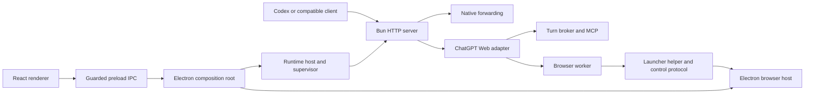

# NEKODEX architecture

This is the maintained architecture of this checkout. Use it with the
[feature extension guide](docs/development/extending-nekodex.md) and generated
[module/dependency map](docs/development/module-map.json). Historical review
reports describe their revisions; they do not override current source. Detailed
[mode and operational contracts](docs/architecture.md) remain a companion reference.

## Product and runtime boundaries

NEKODEX combines a Bun service implementing a Responses-compatible bridge with
an Electron desktop application for accounts, browser turns, tools and runtime
supervision. React renders the launcher UI. Native provider forwarding, automatic
ChatGPT browser execution and Manual handoff are distinct transports.

These arrows describe communication and authority, not permission to import an
orchestration module into every dependency. Browser selection, account identity,
connector readiness, runtime readiness and installed release identity are
separate facts.

## Entry points and responsibilities

| Area | Entry points / owners | Boundary |
| --- | --- | --- |
| CLI and service | [cli.ts](src/cli.ts), [argument helpers](src/lib/cli-args.ts), [service.ts](src/service.ts), [LaunchAgent helpers](src/launch-agent.ts), [server.ts](src/server.ts) | Configuration selects host/port; server admission, local-request checks and stream settlement protect the HTTP boundary. Default configuration uses port 17841. The daemon and tunnel services share LaunchAgent path, launchd domain and status-probe helpers; each keeps its own label, plist template and timeouts. |
| Request parsing | [Responses parser](src/responses/parser.ts), [schema](src/responses/schema.ts), [HTTP body](src/http-body.ts) | Validate input before dispatch; optional reasoning summary/content/encrypted content accept Desktop replay nulls as absence, while populated values retain strict validation. Native forwarding retains the original request bytes; transformed bytes require matching headers. |
| Response translation | [SSE bridge](src/bridge.ts), [JSON projection](src/responses/json-output.ts), [shared output policy](src/responses/output-policy.ts) | Stream cancellation/backpressure stay with SSE; both forms use the same usage/error/tool conventions. Unknown usage is not zero. |
| Continuations | [continuation scope](src/responses/continuation-scope.ts), [owner derivation](src/responses/continuation-owner.ts), [state](src/responses/state.ts), [snapshot codec](src/responses/state-snapshot.ts) | Scope derivation has no disk side effects. Live retention/persistence and snapshot encoding are separate; response IDs must remain bound to their owner. |
| Native transport | [forwarding](src/native-passthrough.ts), [request preparation](src/native-request-preparation.ts), [network routing](src/native-network.ts), [body delivery](src/native-response-body.ts), [terminal inspector](src/native-terminal-inspector.ts) | Preserve authoritative bytes and cancellation. Telemetry observes outcomes; it cannot change delivery or invent provider usage. |
| Web orchestration | [adapter](src/adapters/chatgpt-web/index.ts), [turn runtime](src/adapters/chatgpt-web/turn-runtime.ts), [execution registry](src/adapters/chatgpt-web/turn-execution.ts), [session](src/adapters/chatgpt-web/turn-session.ts), [tool-result projection](src/adapters/chatgpt-web/broker-tool-result.ts), [rejected tool results](src/adapters/chatgpt-web/rejected-tool-results.ts) | One runtime/registry owns a turn. Reconnection replays journalled events instead of submitting another browser task. Ordinary rounds and active compaction share one Codex tool-result to broker payload projection. A follow-up that fails request validation answers its matched outstanding calls with an explicit error and fails that browser turn. |
| MCP and tools | [MCP server](src/adapters/chatgpt-web/mcp-server.ts), [routing](src/adapters/chatgpt-web/mcp-tool-routing.ts), [broker](src/adapters/chatgpt-web/turn-broker.ts), [owned operations](src/adapters/chatgpt-web/turn-broker-owned-operations.ts), [broker event log](src/adapters/chatgpt-web/turn-broker-diagnostics.ts) | Schema discovery is not authorization. Bind invocation and result acknowledgement to exact turn/operation identities; keep replay guards. A never-dispatched call with no Codex consumer for 25 s is cancelled, not retained. The background daemon writes broker lifecycle events (identifiers and counts only) to `diagnostics/turn-broker-events.jsonl`; the MCP process releases its leases on SIGTERM/SIGINT/stdin close. |
| Environment authority | [environment](src/adapters/chatgpt-web/environment.ts), [envelope syntax](src/adapters/chatgpt-web/environment-envelope.ts), [resolver](src/adapters/chatgpt-web/thread-environment-resolver.ts) | Parsing an envelope does not establish provenance or grant access to a working directory. |
| Prompt and files | [prompt compiler](src/adapters/chatgpt-web/prompt.ts), [context envelope](src/adapters/chatgpt-web/prompt-context-envelope.ts), [multipart contract](src/adapters/chatgpt-web/prompt-multipart-contract.ts), [input policy](src/adapters/chatgpt-web/browser-input-policy.ts), [attachments](src/adapters/chatgpt-web/attachment-payloads.ts), [file content](src/responses/file-content.ts) | Keep request validation, authorized bytes, transport formatting and account capacity independent. Multipart acknowledgements and commit identify one transaction. |
| Browser automation | [worker](src/adapters/chatgpt-web/browser-worker.ts), [model selection](src/adapters/chatgpt-web/browser-model-selection.ts), [page guards](src/adapters/chatgpt-web/browser-page-guards.ts), [stage budget](src/adapters/chatgpt-web/browser-stage-budget.ts), [submission policy](src/adapters/chatgpt-web/browser-submission-policy.ts), [submission DOM](src/adapters/chatgpt-web/browser-submission-dom.ts), [response DOM](src/adapters/chatgpt-web/browser-response-dom.ts) | Worker owns acquisition/send/rebind/settlement and chooses each stage and its budget. Page guards classify blocking dialogs/alerts without owning the page; the stage budget owns timeout and sleep-refund mechanics; submission policy is pure evidence/turn-identity logic the worker consults. DOM readers return observations; a proven detached response permits the worker to rebind only to the unique accepted replacement, while evaluation faults on present nodes remain errors. Cached evidence stays tied to the document/turn. |
| Progress and diagnostics | [response policy](src/adapters/chatgpt-web/browser-response-policy.ts), [visible trace](src/adapters/chatgpt-web/browser-visible-trace.ts), [diagnostics](src/adapters/chatgpt-web/browser-diagnostics.ts) | Live external work suspends terminal grace windows, not the task deadline. Diagnostics retain bounded structural evidence; screenshots are opt-in. |
| Compaction | [transaction](src/adapters/chatgpt-web/compaction-transaction.ts), [run registry](src/adapters/chatgpt-web/compaction-run-registry.ts), [active source](src/adapters/chatgpt-web/active-compaction-source.ts), [rolling checkpoint](src/adapters/chatgpt-web/rolling-checkpoint.ts) | Logical cancellation and physical settlement differ. Publish a checkpoint in memory only after its durable write succeeds. |
| Configuration/setup | [config](src/config.ts), [setup](src/setup.ts), [setup policy](src/setup-policy.ts), [file transactions](src/file-transactions.ts), [Codex integration](src/codex-integration.ts) | Bind candidate writes to the original snapshot. `useSavedChats` defaults off, validates as a boolean, and remains independent of fresh-per-turn behavior. Optional `nativeBackgroundRoute` (`DIRECT` or an exact HTTP(S) origin) is written only by `setup --native-background-route`, validated by both config parsers, and reaches the daemon solely as `CODEX_CHATGPT_WEB_NATIVE_BACKGROUND_ROUTE` from the supervisor's `spawnChild`, where an explicit environment value wins; PAC/route-cache evidence never produces it. A committed-write receipt differs from a before-image; rollback cannot overwrite a newer owner's edit. |
| Account tunnels | [binding store](launcher/electron/account-tunnels.cjs), [peer supervisor](launcher/electron/account-tunnel-supervisor.cjs), [account pool](launcher/electron/account-pool.cjs), [runtime host](launcher/electron/runtime.cjs) | `accountTunnelMode` enables strict one-account/one-mode ownership. `accountTunnels` holds distinct cloud IDs, aliases, profiles and scoped protected references (or explicit legacy key paths). A captured config generation and immutable credential are prepared before only the affected peer stops; commit checks the captured config bytes and link target. Peer startup creates the private profile before inventory; healthy peer monitoring describes transport readiness while the production parent owns broker admission. Missing/unready bindings never borrow another account's tunnel. New or explicitly reconfigured bindings derive SDK-global aliases from the canonical application home, account and mode so DEV and production cannot collide; loading a saved binding does not silently rename it. Changed sign-in fingerprints retire readiness. Native forwarding and healthy peers remain independent. A peer records the PID and start identity it verified; while they match, supervision, recovery and Quit use only local signals, never tunnel-client's remote `runtimes status` lookup. A failed first start enters the same backoff recovery, and the parent's Web repair action reconnects failed or backed-off peers. |
| Tunnel | [installation/control](src/tunnel.ts), [status interpretation](src/tunnel-status.ts), [service](src/tunnel-service.ts) with [LaunchAgent helpers](src/launch-agent.ts) | Inventory/diagnostics parsing has no process authority. Scoped stopped proof requires successful inspection, an explicitly non-running process and stopped state; the SDK's missing/null/empty error values mean no status error. Installation, credentials and readiness remain separate steps. |
| Electron composition | [main](launcher/electron/main.cjs), [preload](launcher/electron/preload.cjs), [IPC registrars](launcher/electron/ipc), [control server](launcher/electron/control-server.cjs) | Main owns guarded IPC and composition. Renderer inputs and helper calls cross validation/admission boundaries. |
| Native plan content | [source observer](src/adapters/chatgpt-web/task-plan-observation.ts), [capture policy](src/adapters/chatgpt-web/task-plan-policy.ts), [wire validator](launcher/electron/task-plan-observation.cjs), [store](launcher/electron/task-plans.cjs), [requirements](launcher/electron/task-plan-requirements.cjs), [TaskPlans](launcher/src/TaskPlans.tsx) | Separate opt-in content store, never the metadata ledger. `/v1/turn/plan` validates the exact live trace/helper/surface/task and recorded native thread/turn before capture; observed plan claims remain unverified. Explicit requirements/corrections and CAS-bound associations retain trusted action metadata separately from personal user confirmation; property verification is unavailable here. |
| Conversation text history | [store](src/conversation-history/store.ts), [Agent events](src/conversation-history/transcript.ts), [owned conversation events](src/conversation-history/owned-conversation.ts), [private claim bridge](src/conversation-history/owned-conversation-bridge.ts), [HTTP](src/conversation-history/http.ts), [IPC](launcher/electron/ipc/conversation-history.cjs), [surface](launcher/src/ConversationHistorySurface.tsx) | One Bun SQLite/FTS writer; selected text, page refresh, partial Agent summaries and future canonical owned-conversation text have separate default-off policies and scope families. Exact current claims, pre-offer leases, recording/consent epochs, deletion watermarks and deny-first revocation govern capture. Full independently owned external-client feeds remain unavailable. |
| Local project workspace | [service](launcher/electron/local-workspace.cjs), [IPC](launcher/electron/ipc/workspace.cjs), [surface](launcher/src/WorkspaceSurface.tsx), [editor leaf](launcher/src/WorkspaceEditor.tsx) | Native picker grants opaque roots; main owns bounded reads/drafts/revision-aware writes. Surface owns navigation; editor leaf preserves the same per-file queue/editorPort/save/recovery lifecycle. Read-only comparisons, snapshots and explicit Git mutations are distinct owners. |
| Native Codex thread control | [client](launcher/electron/codex-client-control.cjs), [transport](launcher/electron/codex-app-server-connection.cjs), [handoff](launcher/electron/codex-thread-handoff.cjs), [recorded tier](launcher/electron/codex-rollout-settings.cjs), [IPC](launcher/electron/ipc/codex-client-control.cjs), [surface](launcher/src/NativeThreadsSurface.tsx), [handoff panel](launcher/src/NativeThreadHandoffPanel.tsx), [projection](launcher/src/native-threads-model.ts) | Supported metadata and explicit exact-turn fork use a durable journal; returned boundary starts no execution and reports observed stored-attachment parity. Server/idle metadata is not exclusive authority. The separate handoff service owns one stdio app-server per explicit action and relies on Codex's per-thread writer lock for exclusivity: acquire with the thread's own recorded service tier, one turn, terminal state, release; that thread's approvals are declined. |
| Retained owned Native conversations | [owner](launcher/electron/persistent-native-conversations.cjs), [worker](launcher/electron/owned-native-worker.cjs), [IPC](launcher/electron/ipc/native-persistent-conversations.cjs), [panel](launcher/src/NativePersistentConversationsPanel.tsx) | Exact conversation/thread reservations and synchronous quota writer permit independent known operations. Fork reserves source; alias/unknown creation holds owner. Explicit identity-checked Resume sends no turn; per-selection UI never bypasses account/uncertain-owner gates. |
| Native owner recovery | [transaction](launcher/electron/native-account-recovery.cjs), [macOS observer](launcher/electron/native-recovery-processes.cjs), [contract](docs/design/native-owner-recovery.md) | Explicit preview and separately confirmed stable plan archive only verified stale ownership markers after physical process absence. Passive exact receipt reconciliation never replays a prior effect; partial archives retain uncertainty and ownership. Account authentication, model requests and original journals remain separate. |
| Owned Native inference leaf | [admission](launcher/electron/owned-native-admission.cjs), [worker](launcher/electron/owned-native-worker.cjs), [receipts](launcher/electron/owned-native-journal.cjs) | The trusted [auth authority](launcher/electron/native-account-authority.cjs) owns explicit fresh-profile official CLI device login; the [inventory owner](launcher/electron/native-account-inventory.cjs) qualifies only its own exact personal-Pro-family profile (`pro`, `prolite`, `promax`), native account/usage and original catalog; the actual plan value is retained. Explicit qualification prepares the shared account process and validates effective configuration plus current account/usage before advertising available models; this opens no thread or inference turn. Preparing/failed/closed owners remain unavailable. Restart or update deliberately leaves models offline until that explicit check (no automatic network/model call). The [offline projection](launcher/src/native-models-offline.ts) drives a one-click banner in the Agent mode accounts panel and in Agent tools provider authorization, and OAuth status reports `account_authority_offline`. The [execution owner](launcher/electron/native-account-execution.cjs) seals qualified model metadata and resolves model/admission pairs into one account stdio process/AuthManager/sender with up to two new isolated task threads. Main/Bun/Agent UI use a private descriptor and fixed protocol. Model rows advertise optional maxConcurrent capacity (absent means one); saved tasks retain their own bound, within the account subscription quota. An isolated personal Pro (Max) account and two real models have been admitted and exercised; this does not establish all-account or installed-app acceptance. The pinned public-library Rust wrapper keeps mandatory policy; network-denied `--account-info` classification is separate from cloud-aware startup checks. Fixture-route official-account refusal remains unchanged. Existing metadata/fork authority is unchanged; neither fake-provider evidence nor a compiled wrapper proves real delivery. The auth authority alone removes a profile (`remove-profile`): it refuses a live login or held inventory/execution lease, and refuses a signed-in profile (settled state or a persisted CLI credential, checked by `lstat`) without explicit confirmation. Native account IPC closes only the exact owned execution of that profile first, and only when confirmed. One atomic registry write retires the row and its earlier receipts and records a `remove-profile` intent; the private profile tree is then erased and the receipt completed. A later owner finishes an interrupted erase, and owner recovery accepts these receipts without a live profile scope. Before erasing a signed-in profile, main runs every refusal through `checkRemovable` (no intent; only the execution lease main closes next is tolerated). It then calls OAuth `retireAccount('native:<id>')` and closes the execution last, so a refusal or failed retirement leaves the profile and its execution in place. Only a fresh epoch skips the credential acknowledgement. Removal never revokes the OpenAI-side session. |
| Standalone Agent mode | [store](src/agent-mode/store.ts), [runner](src/agent-mode/runner.ts), [runtime](src/agent-mode/runtime.ts), [Responses port](src/agent-mode/provider.ts), [Native port](src/agent-mode/native-provider.ts), [main bridge](launcher/electron/agent-native-bridge.cjs), [HTTP actions](src/agent-mode/http.ts), [semantic review](src/agent-mode/semantic-review.ts), [IPC](launcher/electron/ipc/agent-mode.cjs), [surface](launcher/src/AgentModeSurface.tsx) | A separate task family owns stages, explicit acyclic stage dependencies, durable mailbox/dispatch/command receipts and bounded Goal/Loop. Independent Native stages may overlap within the advertised task capacity. A typed final result is published only after its exact binding has retired and the SDK thread has physically closed; tool requests and user waits retain that binding, while unknown retirement retains ownership and prevents replay. The existing Responses owner executes configured Web routes and advertises explicitly enabled MCP descriptors. Durable pending tool calls require exact approval/results before canonical continuation; snapshot grants grant no tool/filesystem authority. Corrections restore only the durable current-cycle claimed mailbox text as data across new stage IDs; no continuation, tool grant or Run authority follows that text. Monetary cost remains unknown without an actual receipt. Scoped, command-receipted `archive` applies only to a stopped or verified-complete task with no owner, Loop run or unsettled dispatch. A verified task must also have no unknown or missing current tool outcome. Archive sets `archivedAt` and keeps every dispatch, receipt, mail, tool outcome and evidence row. Late ledger rows and usage accounting (`spent`, `reserved`, `unpricedTurns`) still land; every other write to the task row is refused. Default HTTP and local-control listings hide archived tasks and report their count; `get` still reads them. Agent HTTP `status`/`list` optionally accept bounded `listing` query/view/offset and return25 small task summaries with nextOffset; archive browsing remains read-only. The renderer blocks archived mutation/authority controls. A stopped, ownerless task's `unknown` send is closed for archive only by the scoped, command-receipted `reconcile-dispatch` user record (`abandoned`, or `confirmed_delivered` backed by the dispatch's own acceptance receipt), kept as a separate `dispatch_disposition` receipt; the dispatch stays `unknown`, nothing is resent and accounting is unchanged. The [confirmation dialog](launcher/src/AgentDispatchReconciliation.tsx) states this. |
| Human workspace terminal | [PTY service](launcher/electron/workspace-terminal.cjs), [IPC](launcher/electron/ipc/workspace-terminal.cjs) | Main-owned session/generation and picker grant; bounded output/ack/backpressure and exact PTY lifecycle. Main/preload/Workspace UI and xterm are wired; native `node-pty` availability/ABI remains platform-specific. The build prerequisite prepares executable Unix spawn helpers and checks a real shell in the selected Electron. Human input is not an Agent tool. |
| Project worktrees and manual restore | [Git mutations](launcher/electron/workspace-git-mutations.cjs), [local Git review](launcher/electron/local-git-review.cjs), [capture](launcher/electron/workspace-file-capture.cjs), [IPC](launcher/electron/ipc/workspace-git.cjs) | Main serializes exact reviewed stage/unstage/commit and worktree/snapshot/restore receipts, with draft conflicts, complete index and before-images. Unknown commit/publication is inspection-only; read-only diff remains distinct. |
| Remote project workspace | [SSH/SFTP owner](launcher/electron/remote-workspace.cjs), [remote worktrees](launcher/electron/remote-worktrees.cjs), [IPC](launcher/electron/ipc/remote-workspace.cjs), [surface](launcher/src/RemoteWorkspaceSurface.tsx) | System SSH owns authentication/known-host policy; selected host/root identity binds reads, drafts, commands and remote Git. One-use approvals and signed durable receipts distinguish completed/unknown; reconnect does not replay mutations. |
| Remote Git Review | [controller](launcher/electron/remote-git-review.cjs), [fixed helper](launcher/electron/remote-git-review-helper.cjs), [surface](launcher/src/RemoteGitReview.tsx), [contract](docs/design/remote-git-review.md) | The existing remote owner supplies host exclusivity, authenticated transport and signed storage. Opaque base/capture identities bind HEAD, index and repository state. Stage/unstage/commit have distinct reviewed action IDs; atomic main admission/settlement pairs action records with receipts. The remote ledger and common-directory owner retain uncertain outcomes for exact inspection without replay. This human Git interface grants no Agent tool authority. |
| Agent snapshot authority | [main grant signer](launcher/electron/agent-workspace-grant.cjs), [Bun snapshot store](src/agent-workspace/store.ts) | Picker-authorized exact paths are signed for task/family/generation, scope `pre-turn-snapshot-only`. The Bun before-offer hook persists one immutable dispatch baseline before execution; this grants no executor filesystem access. |
| Standalone MCP and skills | [composition](src/agent-tools/composition.ts), [host](src/agent-tools/mcp-host.ts), [journal](src/agent-tools/journal.ts), [skills](src/agent-tools/skills.ts), [managed versions](src/agent-tools/managed-skills.ts), [Python environment](src/agent-tools/skill-python-environment.ts), [dependency policy](src/agent-tools/skill-python-requirements.ts), [installer](src/agent-tools/installer.ts) | Exact approval/outcome owner serves configured and builtin tools. Concurrent discovery builds independent catalog candidates and publishes only complete validated snapshots after scope/abort rechecks; discovery never grants invocation authority. Frozen official recipe graph/tree integrity, separate save/enable/connect/effect, immutable skill versions and selected environment Attach remain distinct. OAuth uses a separate protected service; stdio recipes remain auth:none. |
| Isolated VM execution/builds | [executor](src/execution-environments/executor.ts), [product](src/execution-environments/product.ts), [production origin](src/execution-environments/production-runtime.ts), [Python build](src/execution-environments/python-build.ts), [selection bridge](src/execution-environments/launcher-python-build-selection.ts), [native picker](launcher/electron/python-build-picker.cjs), [host network](src/execution-environments/network.ts) | Exact runtime brand, user-wide durable owner and physical stop/join govern effects. Build, mediated network grant and workspace export each retain separate approval/receipt scope. Production source admission does not establish installed VM execution; guest NIC remains unavailable. |
| Protected MCP OAuth | [public action port](src/agent-tools/oauth.ts), [task provider](src/agent-tools/oauth-mcp-provider.ts), [private bridge](src/agent-tools/oauth-mcp-bridge.ts), [binding controller](launcher/electron/oauth-mcp-controller.cjs), [HTTPS transport](launcher/electron/oauth-mcp-transport.cjs), [broker](launcher/electron/agent-oauth.cjs), [launcher](launcher/electron/agent-oauth-launcher.cjs), [vault](launcher/electron/agent-oauth-vault.cjs), [service](launcher/electron/agent-oauth-service.cjs), [IPC](launcher/electron/ipc/agent-oauth.cjs), [panel](launcher/src/AgentOAuthPanel.tsx) | Separate protected CAS credential scope and trusted provider/account configuration; safe renderer actions/status only. Pending refresh/revoke persists before network; actual human consent and admitted MCP transport effect remain independent of service construction. `oauthRemoveProvider` invalidates MCP bindings deny-first, revokes any held credential, and requires a disconnected/revoked status. It then requires every binding consumer to acknowledge durable removal, and only then drops the row through the same lock, stamp check, revision increment and durable atomic write as registration. Main-only `retireAccount` does the same for every provider of a removed Native account. Its broker is bound to the unchanged registry revision, its invalidation is account-scoped and its write is revision-checked, so it needs no current authority. Binding pins and receipt journals stay. |
| Browser companion/providers | [host](src/browser-companion/host.ts), [runtime](src/browser-companion/runtime.ts), [protocol](src/browser-companion/protocol.ts), [ChatGPT transport](src/browser-companion/chatgpt-transport.ts), [worker port](src/adapters/chatgpt-web/companion-transport-port.ts), [Chrome manifest](browser-companion/manifest.json), [Firefox manifest](browser-companion/manifest.firefox.json), [page ChatGPT function](browser-companion/chatgpt.js), [privacy policy](browser-companion/PRIVACY.md), [IPC](launcher/electron/ipc/browser-companion.cjs) | Popup pairs/selects; session owns one no-replay poller; dispatcher targets exact active document. Firefox pins profile-specific origin. Approved optional pixels and exact text-transition evidence are separate from input execution. Chrome ID is fixed by the manifest key and pinned by runtime/IPC/surface. ChatGPT send: the worker's `run` stays the only sender/registry and routes to the companion port only turns that opt in by naming the bound account (Local API header); the leaf sends once to an explicitly bound chatgpt.com document/account/visible model and holds unknown outcomes without replay. |
| Native desktop tools | [helper](launcher/native/desktop-provider.swift), [controller](src/browser-companion/macos-desktop.ts), [task tools](src/browser-companion/agent-desktop-tools.ts), [property evidence](src/browser-companion/desktop-outcome.ts), [builder](scripts/build-desktop-helper.cjs) | Explicit macOS14+ permission/window/task-generation authority; bounded capture, fresh AX/CG input and separate AX property reads. The disclaimed serving helper owns one outer AppKit application loop and an opaque main-thread consent window whose one-shot checked continuation yields the actor for drawing and input; only explicit Allow plus an intact caller chain records process-local consent, with no expiry. Canonical property evidence is point-in-time and revalidated against current attachment/operation; input success is not business acceptance. |
| Builtin tool continuation | [tool contract](src/agent-tools/types.ts), [browser leaf](src/browser-companion/agent-tools.ts), [host](src/agent-tools/mcp-host.ts), [image projection](src/agent-mode/tool-images.ts), [Agent runtime/store](src/agent-mode/runtime.ts) | MCP and builtin browser/desktop calls share one approval/journal/outbox; reconciliation reads exact retained receipts without executing. Canonical result images remain tool-call outputs; immutable late facts preserve prior unknown outcomes. |
| Local control API | [routes](src/local-control-api/http.ts), [policy](src/local-control-api/policy.ts), [client](src/local-control-api/client.ts), [TaskMonitor](src/local-control-api/task-monitor.ts), [command](src/local-control-api/task-monitor-command.ts), [IPC](launcher/electron/ipc/local-control-api.cjs) | Passive bounded reads and scoped explicit actions use existing Agent owner. Named monitor stores one-submit action journal and reconciles exact receipts without resend. An unopened owner after restart is unavailable, not absent. |
| Cross-client usage | [service](launcher/electron/external-usage.cjs), [pure formats](launcher/electron/external-usage-formats.cjs), [pricing](launcher/electron/usage-pricing.cjs), [IPC](launcher/electron/ipc/external-usage.cjs), [surface](launcher/src/ExternalUsageSurface.tsx) | Consent/path/I/O/cursors/dedup/commits stay in service; pure Codex/Claude/Gemini parser returns allowlisted metadata and context. Dated/imported exact-model scenarios are API-equivalent estimates with unknown/overlap coverage, never bills/savings. |
| Browser ownership | [host](launcher/electron/browser-host.cjs), [turn lifecycle](launcher/electron/browser-turn-lifecycle.cjs), [Manual turns](launcher/electron/browser-manual-turns.cjs), [artifact transfers](launcher/electron/browser-artifact-transfers.cjs), [workspaces](launcher/electron/browser-workspace-windows.cjs), [navigation policy](launcher/electron/browser-navigation-policy.cjs), [session probe script](launcher/electron/browser-auth-probe.cjs), [verified-session presentation](launcher/electron/browser-session-presentation.cjs), [in-page session check](launcher/electron/browser-session-observation.cjs), [app user agent](launcher/electron/browser-user-agent.cjs), [network egress check](launcher/electron/network-egress-check.cjs), [announcement dismissal](launcher/electron/browser-announcements.cjs) | One shared tab map. Ledger settlement precedes removal receipts. Concrete task auth redirects retire cached identity and emit an authentication-required release receipt; a false completion becomes a retained failure, while explicit cancellation keeps its own outcome. Manual policy uses explicit ports; artifact delivery rechecks exact ownership after awaiting download. URL policy (including the toolbar address resolution), the page probe, the in-page session check and the automatic-surface announcement dismissal are stateless leaves; a typed ChatGPT address always loads in the ChatGPT tab so retained task tabs keep their conversation. The app presents one stable Chromium user agent on every view and cross-site frame because Cloudflare binds its clearance to it. After a Cloudflare challenge the host checks, at most every ten minutes and in a throwaway session with the account's network settings, whether the public address changes between connections, and publishes only the verdict; the host owns probe sequencing, dismissal enablement and published authentication state. |
| OpenAI API panel | [panel policy](launcher/electron/openai-api-panel.cjs), [workspace window owner](launcher/electron/browser-workspace-windows.cjs), [host](launcher/electron/browser-host.cjs), [account pool](launcher/electron/account-pool.cjs) | Human-operated Tunnels/API keys windows use the explicitly selected account session and fixed Platform destinations. The panel stays outside task descriptors, does not persist portal/OAuth URLs in ChatGPT workspace manifests, and participates in account authentication mutation leases. Opening a panel does not establish tunnel access or create a ChatGPT connector. |
| Accounts/authentication | [account pool](launcher/electron/account-pool.cjs), [browser display projection](launcher/electron/account-browser-snapshot.cjs), [registry](launcher/electron/account-registry.cjs), [operation leases](launcher/electron/account-operation-leases.cjs), [Codex login](launcher/electron/codex-login.cjs), [browser login](src/browser-login.ts) | Preserve account/principal/flow identity and exact operation leases. Only the selected host supplies full navigation observations; other hosts supply turn rows. Display projection has no session authority. Temporary verification failure does not establish logout. Synchronous pacing-policy edits and resume validate an existing account and open pool but do not acquire browser-operation ownership; they affect future admission while current reads, sign-in and turns retain their owners. Optional session limits and scheduled breaks remain derived from the enabled policy; they never latch into provider stop/cooldown fields. An explicitly selected or already pinned account treats cached model discovery as advisory: the worker selects and verifies the exact model and effort before sending. Unbound balanced routing still requires model evidence. An explicitly selected or already pinned account may establish connector availability during the real pre-send flow; unbound balanced routing still requires prior connector evidence. A completed tool result can promote the exact connector only while the captured principal and identity epoch still match. |
| Runtime supervision | [runtime host](launcher/electron/runtime.cjs), [supervisor](launcher/electron/runtime-supervisor.cjs), [generation store](launcher/electron/runtime-generation.cjs), [tunnel policy](launcher/electron/runtime-tunnel-policy.cjs), [poll health](launcher/electron/tunnel-poll-health.cjs), [output decoder](launcher/electron/runtime-output.cjs) | RuntimeHost owns setup transitions; supervisor owns daemon/tunnel processes and readiness. The tunnel monitor counts only local evidence as failure: timed-out control commands are unknown, an exited process fails at once, and a long silent local endpoint fails after about a minute. tunnel-client `/metrics` poll series mark a locally healthy tunnel degraded with reason `openai_unreachable` (no restart) after 75 s without a successful poll; the reason reaches `/admin/tunnel-status`, `/healthz` and the Web admission message. Recovery never disables itself: after the fast budget it backs off from 15 s to 5 min. Decode split UTF-8 once and bound every log line independently of raw capture. The control error projection reads bounded receipts and passes only exact fixed refusals from its allowlists (opt-in Agent conflicts, browser-companion owner refusals); any other daemon text keeps the generic message or bare HTTP status. |
| Updates | [controller](launcher/electron/update.cjs), [release policy](launcher/electron/update-release-policy.cjs), [staging](launcher/electron/update-staging.cjs), [validation](launcher/electron/update-validation.cjs), [worker](launcher/electron/update-worker.cjs), [commit observation](launcher/electron/update-commit.cjs) | Packaged repository/channel selects candidates; signature validation, preparation, handoff and detached installation are separate owners. Discovery falls back from the REST API to the signed Atom feed on any failure. The replacement launcher owns in-session runtime activation after the worker commits. |
| Usage | [Native contract](src/usage/native-contract.ts), [outbox](src/native-usage-outbox.ts), [durable store](launcher/electron/usage-store.cjs), [report projection](launcher/electron/usage-report.cjs) | Receipt validation and persistence remain independent of UI aggregation. Preserve unknown fields and source/account scope. |
| UI | [App](launcher/src/App.tsx), [shell chrome](launcher/src/AppShell.tsx), [update controls](launcher/src/useUpdateControls.ts), [deferred surfaces](launcher/src/deferred-surface.tsx), [presentation log store](launcher/src/launcher-log-store.ts), [Onboarding](launcher/src/Onboarding.tsx), [Accounts](launcher/src/AccountSettings.tsx), [Browser](launcher/src/BrowserSurface.tsx), [Activity](launcher/src/ActivitySurface.tsx), [Task Center](launcher/src/TaskCenter.tsx), [Settings](launcher/src/SettingsSurface.tsx) | App owns shell state/navigation/shared snapshots; AppShell renders prop-driven chrome and the compact-drawer focus trap, and `useUpdateControls` owns update check/install/cancel state. Optional screens load on navigation; logs update subscribed views instead of App. Settings exposes saved-chat preference through guarded preload IPC; saved/temporary behavior remains a runtime/browser contract. Feature surfaces and hooks own local drafts/actions; late results stay with their original account/query/flow. |
| Design system | [tokens](launcher/src/tokens.css), [component kit](launcher/src/design/index.ts), [kit styles](launcher/src/design/components.css), [appearance](launcher/src/theme.ts), [modal focus](launcher/src/modal-focus.ts) | Tokens own every colour and scale; dark is the default and light applies through `html[data-theme]`, set from the saved Appearance preference by `theme.ts` (and before first render by `theme-boot.ts`, from the appearance the renderer last applied or else the theme the main process resolved and passes as `?theme=`). Kit components are presentational: props in, callbacks out, no IPC or launcher state, and user-visible labels come from the caller's localized copy. Surfaces compose the kit and keep only layout in `launcher/src/surfaces/*.css`, using semantic tokens. `Page` supplies the frame; opt-in `PanelStack` supplies vertical peer-panel spacing and `BadgeRow` supplies wrapping sibling status spacing. Button/Badge internal gap does not space siblings. The shared MCP icon name now renders a toolbox; changing its glyph grants no tool capability. |
| Presentation observations | [publication scheduler](launcher/electron/browser-state-publication.cjs), [account reader](launcher/src/account-snapshot-controller.ts), [observation comparison](launcher/src/snapshot-observation.ts) | Pool invalidation stays synchronous; presentation snapshots coalesce per event-loop turn. Source/revision stamps order observations, not authorization. |
| Localization | [locale catalog](launcher/src/locale-catalog.ts), [subscription hook](launcher/src/useLocaleCopy.ts), [language selection](launcher/src/language-selection.ts), [message facade](launcher/src/i18n.ts) | English is immediately available. Other dictionaries load independently and share pending requests. Prepare before saving; a superseded preparation cannot overwrite the latest choice. The launch and startup-failure screens, shown before the first snapshot, use the last presented language (`shell-copy.ts`), else the system language. |
| DEV harness | [CLI](src/dev-chat/cli.ts), [driver](src/dev-chat/driver.ts), [session store](src/dev-chat/session.ts), [context fixtures](src/dev-chat/context-fixtures.ts), [transport](src/dev-chat/transport.ts) | Isolated DEV state and inert generated content are distinct. DEV setup persists saved/temporary chat policy in the isolated config; model selection uses the same real route identities as production. The harness attaches to the launcher's existing DEV tunnel rather than taking over supervision. |
| Build and distribution | [runtime bundler](scripts/build-runtime-bundle.ts), [owned build output](scripts/build-output.cjs), [launcher scripts](launcher/scripts), [Native release inputs](scripts/native-release-inputs.cjs) and [their lock](launcher/native/release-inputs.json), [CI](.github/workflows/ci.yml), [release workflow](.github/workflows/release.yml) | Generated output must be owned before replacement. Development checks precede separately authorized packaging/publication. Release packaging admits the accepted macOS arm64 worker and VM guest by the lock's byte pins, never by checkout path; CI fetches them from a content-named transport release. |

## Important end-to-end flows

An owned Web security-check failure remains a permission denial. Because Codex retries unknown streamed error codes and HTTP 403, the next matching replay is rejected before adapter dispatch with HTTP 400, preserving `chatgpt_security_check`, `permission_error`, and `upstream_status: 403`. The bounded replay marker is consumed so a later deliberate retry can re-check the account. It does not authorize replaying the rejected browser submission.

On retained browser pages, an unchanged closed model control may reuse its prior selection only when the page URL, requested family, effort and visible label still match. The final pre-send family, slider-value and availability check always remains live; the cache only avoids redundant selection actions.

Existing-Chrome sign-in separates machine work from human consent: discovery and CDP reads retain bounded deadlines, while Chrome's native Allow handshake waits until permission, explicit cancellation, or a transport failure. The capture budget resumes after consent, and the parent process does not impose a wall-clock deadline over that human wait. The guide hides its countdown while waiting for consent or file access.

1. **Web request:** parse and route → derive continuation/environment ownership →
   create or recover turn session → compile prompt/attachments → acquire the owned
   browser page → submit once → observe browser/MCP progress → journal events →
   translate to SSE/JSON → settle and retain only the permitted continuation.
2. **Native request:** prepare route/body → obtain the permitted network route →
   forward bytes → inspect terminal usage without changing delivery → enqueue a
   validated receipt for the launcher. Client cancellation stops that caller's
   wait without cancelling unrelated shared resolution.
   Body validation owns typed client failures (400 malformed data, 413 size limit,
   415 encoding); forwarding maps only those failures to client responses.
   Unexpected input-stream/internal failures and cancellation retain their error path.
3. **Manual request:** reserve an owned tab → copy prompt → wait for user Sent
   confirmation → execute through the harness → settle. The human submission
   deadline refreshes on Copy and ends at Sent. A premature Sent leaves the prompt
   copyable until the connector actually binds. Runtime cancellation must be acknowledged before the
   tab is removed; delayed acknowledgements cannot retire a replacement owner.
4. **Account sign-in:** capture target account/flow → acquire the exclusive lease
   → verify the captured session/principal → publish a matching receipt → release
   after owned work settles. A failed start with unknown host state requires a
   fresh status read before another start.
5. **Setup/change:** read original configuration snapshot → compute candidate →
   coordinate runtime drain/transition → publish files with receipts → verify →
   commit the new runtime generation. Recovery preserves newer external changes.
   Account tunnel updates hold the captured account's exclusive lease. First transition
   from legacy shared transport waits for all browser tasks; later updates affect only
   their account/mode. Global settings preserve bindings and never bootstrap a shared
   tunnel while account mode is active. Per-account peer status is aggregated through
   the authenticated `account_tunnels` readiness report; admission still checks the
   selected account's own ready binding.
   Explicit `subagents native` releases only exact still-owned Compatibility V1
   feature/depth overrides, preserving user-enabled V2 settings. Route, catalog
   and hook checks remain strict; ordinary setup does not adopt those edits.
6. **Update:** select a compatible release from the packaged repository → verify
   metadata → acquire authenticated bytes → validate staging → hand off to one
   detached installer → observe its terminal result before selecting the new UI.
   The controller re-checks in the background (six hours, or 30 minutes after a
   failed check), owns the `update-downloads` cache and prunes packages it can no
   longer install, and reports a rollback recorded in `update-worker.log` once
   on the next offer. A committed Linux update removes the previous version
   directory it replaced.
   Download and verification never block tasks; only the worker handoff waits for
   browser turns and setup operations to finish (status `waiting`), and nothing is
   cancelled. Ordinary quit keeps the background runtime serving Native traffic
   while the app is replaced. The replacement launcher proves readiness with that
   surviving runtime, then observes the worker's commit
   ([update-commit](launcher/electron/update-commit.cjs): journal `committed`, or
   a removed journal while its own executable is unchanged) and switches to the
   new runtime generation in the same session (`scheduleRuntimeActivation`) with a
   bounded policy: up to 60 s for a natural idle moment, then a drain of up to
   120 s (30 s for a daemon without drain leases) in which the daemon holds new
   requests briefly and running turns may finish, then the remaining turns are
   cancelled through `/admin/cancel-turns` and the switch completes. Uncancellable
   launcher operations defer the drain visibly. The Updates page shows the phase,
   countdown and **Switch now** (`launcher:runtime-switch-now`) from the
   `runtimeSwitch` lifecycle projection. It never changes the runtime before that
   commit, so a rollback restores an app whose runtime generation is intact. A busy
   runtime at ordinary startup uses the same bounded activation. Every daemon drain
   is a lease (`ServerAdmission`) that its owner renews; an unrenewed drain resumes
   admission by itself, a launcher resumes an orphaned drain when it adopts a
   background runtime and its drain watchdog resumes one that no transition owns.
   Runtime bundle verification ignores Finder `.DS_Store` files. After a generation
   commit, `pruneRuntimeVersions` keeps the app's and configured versions, a pending
   generation's endpoints, one older release and any newer unknown install.

A Web token is scoped to the leased account's tunnel before it reaches ChatGPT.
MCP endpoints capture `--tunnel-id` at startup and include it only on the private
broker protocol. Native claims, async operations and Manual start/completion reject
missing or different endpoints for a scoped token. Legacy unscoped turns retain
their existing contract. No public connector schema or sandbox grant is expanded.

## Browser presentation

`main.cjs` owns shell recovery. After a renderer process failure it creates one
replacement trusted shell and asks the existing account pool to reparent its
WebContentsViews. Browser processes, sessions and turn leases retain their
owners. A failed replacement rolls back to the previous window; an explicit
restart uses the supervisor's idle shutdown instead of requiring background
Native route readiness.

Drawable background primary/running views stay parked beyond the native window's
current content bounds. The BrowserHost owner recomputes this placement on native
resize and fullscreen transitions, including on non-browser pages where React
has no browser-slot ResizeObserver. Hidden placement must not depend on a later
navigation or close the views, sessions, processes or retained drafts.

`BrowserSurface` owns the selected-account control and changes it through the account
pool's `selectAccount` operation. `BrowserWorkspaceManager` consumes that selection;
it has no independent account filter. Its disclosure manages separate user windows
and native macOS window tabs, with selected-account counts and an explicitly global
capacity. These windows are distinct from the embedded home and task tab strip.
The home surface is never counted as a running task by Browser or Overview.

`AccountToolsOnboarding` and `McpSurface` expose OpenAI API for the captured account, including before ChatGPT sign-in is verified. Guarded preload IPC validates the account and a fixed `tunnels`/`keys` section. These independent windows share that account's Electron session, retain their open work on refocus, and remain distinct from ChatGPT workspaces and automated turn surfaces. The user checks the Platform organization and ChatGPT workspace association there before attaching the connector in ChatGPT Plugins.

The embedded location/navigation bar renders only while its page is visible.
Signed-out empty states have one primary sign-in action. External sign-in guides
own their continue/cancel/retry controls, retain embedded-sign-in recovery, and
retire after completion. Expanding the window directory changes the browser slot's
layout; the existing bounds observer remains responsible for native view placement.

## Browser recovery and navigation

`application-reload.cjs` routes native menu reload to the displayed embedded page,
its exact workspace/API window, or the trusted shell. An explicit navigation cancels
and joins a background inspection; a stale testing state does not disable recovery.
Active submitted turns and account-changing operations retain their owner. macOS
secondary accounts expose the same supported Chrome profile import as the primary.

`BrowserWorkspaceWindows` owns loading, failed and renderer-gone state. Initial
programmatic account-changing navigation acquires the same session coordinator as
user navigation. Browser-originated form navigation reuses its same-source coordinator owner and retains the original method/body; it is never replayed with loadURL. Aborted redirects and subframe failures do not settle that owner;
a real main-frame failure, renderer death or closure does. API panels verify the
shared account through its owned ChatGPT surface, not the Platform page's origin.
A failed bootstrap script reports its HTTP status and offers explicit recovery;
lazy-resource failures on an already loaded page do not block it.

Challenge recovery never reloads a human draft or a submitted turn. Source-proven
collapsed user messages use a compiler-owned token or structured text after expansion;
retained-history anchors avoid mistaking older remounted rows for new submissions.
Answer text, HTML and markdown segments share sanitized roots so hidden suggestion
sizing labels cannot contaminate delivery or its fingerprint.
The worker may mark a stable final paragraph streamable after the owned response stream
stops and completed-turn actions render. That proof must persist across another observation
(250 ms); the paragraph's content must still be unchanged for the full stability window, which
for this tail runs from its last change. Blocks bounded by a following block keep the whole
window after that boundary. Markdown retains its mutable-reference guards; the completion
tracker and broker fence still own terminal delivery and wait for tool work. The response
loop polls again when a buffered block is due or the owned stream opens or closes, within its
regular interval. Picker selection checks live state before closing, then
verifies persisted family/effort immediately before Send, without an intermediate reopening.
A queued launcher start is re-polled after 50, 100, 200 and 400 ms, then every 500 ms.

Connector approval cards remain owned by the user when automatic approval is disabled.
Startup account authentication and connector checks stay sequential under their existing
owners, but the selected enabled account is checked first so unrelated account startup
does not delay its first task. Remaining enabled accounts are still checked afterwards.
The page guard never denies them on a timer; it keeps cancellation and heartbeats active
until the card resolves. The worker excludes the observed approval wait from the response
deadline and resets DOM grace tracking before resuming the same submitted turn.

The pinned official tunnel SDK is 0.0.16. CLI, launchd and account peer startup pass
`MCP_STDIO_SEND_INITIALIZED_NOTIFICATION=true`; control commands preserve their
existing environment and cancellation semantics. Installation retains integrity and
rollback checks, with 0.0.12 recognized as the preceding supported installation.

Tunnel credentials share one internal provider in
`launcher/electron/tunnel-credentials.cjs`, with the typed Bun port in
`src/tunnel-credential.ts`. Configuration stores exactly one immutable `os-vault`
reference or an explicit legacy `runtimeKeyFile`. The macOS Security helper binds
each record to canonical application home, account, interaction mode and tunnel;
the saved reference never grants cross-account lookup. New keys use protected
storage by default. Windows/Linux currently require an explicit unencrypted
`legacy-file` choice; unsupported/locked storage never silently falls back.

Electron setup sends new key bytes to the CLI over a captured private stdin
pipe. At SDK launch the exact owner resolves a reference and injects
`NEKODEX_TUNNEL_RUNTIME_KEY` into that child only. The SDK profile stores the
`env:` selector; the MCP CLI removes the inherited key before tool processes
can run. Captured diagnostics scrub the exact injected value. LaunchAgent
startup goes through `tunnel credential-run`, which reads and resolves the
current saved reference on every process start; its plist has no secret.

Account migration remains in `RuntimeHost` and the existing account mutation
lease. Prepare/readback precedes affected-peer settlement and config commit;
saved and ready are separate results. An exact legacy-file retirement receipt
persists until a fresh process and matching SDK selector are verified. A newer
config/file writer or uncertain process state preserves recovery material.
Uncertain vault writes retain opaque ownership receipts under
`runtime/credential-recovery`; local healthy-process monitoring never unlocks
the vault. Generated helper binaries are built from the checked-in Swift source,
unpacked from ASAR, and signed before runtime manifest hashes are sealed.

## State and persistence

`modelCapabilities` stores timestamped, family-specific selectable efforts through
config/login/helper boundaries. Discovery in `chatgpt-session.ts` visits every
picker row and every unlocked level, and attributes each level to the model
version its slider description names (a Latest row's lower levels describe
GPT-5.6 Sol); `names` keeps the model name shown with a version. The shared picker
helpers restore the selected row, effort and draft after inspection, including
menus whose rows unmount. Catalog and unbound balanced account admission use that family
evidence; selected and pinned accounts defer model availability to the exact pre-send
picker check, so stale or missing discovery cannot prevent an explicit attempt.
The older aggregate flags remain compatibility data. Setup refreshes
missing or stale observations; the launcher also saves the selected account's
evidence after each browser check and re-reads an idle, out-of-view picker every
six hours through `config model-capabilities`. The daemon reads the saved
evidence per request, so no restart or Repair is needed. `codex-picker-contract.cjs`
compares the visible Web rows of the catalog Codex loads with the digest the user
confirmed (`codexPickerContract`), whoever rewrote the file, and keeps the Codex
restart request until the picker is confirmed again.
Chrome profile bindings can retain the observed Chrome user agent for compatible
session handoff; it never replaces endpoint/principal verification. Sign-in
mutation receipts are published after the owning lease is released.
Explicit session retries publish a checking state and reject unresolved observations
so every retry surface can report the failure. The browser host records primary
navigation/renderer failures and owned stops of loading pages: retry or embedded sign-in reloads an idle or known-failed
home, while a healthy loaded page and the selected task tab stay intact. A new embedded
sign-in, or successful verification, retires terminal external sign-in guides.
Cancelling a profile chooser before session transfer restores its prior settled
authentication verdict only while the captured generation and identity remain current;
an unresolved cancellation remains unavailable, never an ownerless checking state.
The account pool owns one pending evidence restore per account. Sign-in and
tunnel receipts coalesce into it; a receipt during a check supersedes that check.
Waiting for a user operation or tunnel has no elapsed-time expiry and is not an
active inspection. Admission can still report a missing tunnel while model
evidence is restored for plain requests. Pool destruction cancels pending waits. An explicit tunnel edit cancels and joins only that account's automatic restore before acquiring its mutation lease; active tasks and unrelated user operations still veto it. Repeated authentication changes during one restore get one follow-up check, preventing a failing probe from holding the account indefinitely. Transient unknown/unavailable observations block admission but preserve the in-flight evidence epoch; confirmed logout and identity changes still invalidate it.
The profile chooser keeps the last attempted profile ID per account in memory for
retries, separately from the verified binding on disk. The picker labels these
states separately; capture progress identifies the selected Chrome profile.
Both sign-in and the one-use verification page launch Chrome with the same explicit
user-data directory as that catalog, so another running Chrome profile cannot
receive a profile ID belonging to the selected directory.
Cancelling remains independent of the renderer's pending Retry/Continue request;
the host still owns cancellation, rollback and final settlement.

## Optional client connections

`local-api-access.ts` owns a private revocable API key. `server.ts` admits scoped
loopback API candidates before Native/admin dispatch. `chat-completions/` owns
request validation, bounded stream encoding and exact tool continuation receipts;
the native tool bridge preserves audited `account_not_ready` failures as HTTP 400,
including the account remedy, just like the plain Chat Completions path;
`messages/` translates Claude Messages and never fabricates signed thinking.
`client-turns.ts` is the shared Hermes/Claude receipt owner. Authenticated
in-process `external-client-context.ts` values identify the client and supply an
inert read-only environment to the existing adapter; request bodies cannot grant
Native workspace authority. Clients execute their own declared tools.

`claude-integration.ts` owns reversible settings and a private journal, using
snapshot/compensation writes together with local API activation.
`codex-web-provider.ts` participates in the existing v11 Codex integration
transaction: publish the hashed Web catalog before switching configuration,
preserve original Native selection, and reject foreign provider/catalog edits.
`client-connections.ts` is the private CLI protocol for guarded main-process IPC
in `ipc/client-connections.cjs`. The renderer's `ClientConnections` owns its drafts
and action feedback; API key copying stays in the main process. DEV cannot change
installed clients. None of these modes activates merely by updating the app.

The opt-in `check-claude-client.ts` and `check-web-provider-client.ts` scripts use
actual installed CLIs with disposable profiles and inert model adapters. The UI
preview supplies synthetic client settings, while live browser smoke and the
isolated Electron shell crash check verify their separate boundaries.

## Platform delivery order

The user explicitly selected on18 October2026 at12:11 UTC: the entire agreed
capability set first on macOS, then Windows/Linux. Stage1 therefore retains open
native execution/real-provider/Automatic Goal/remote authentication/skill-resource
work; it is not complete merely because the existing macOS subset passes. Stage2
retains the corresponding Windows/Linux adapters and parity. Unsupported routes
stay explicit until implemented. This priority does not prove installed `.9` or
release and does not authorize broad verification; development, source publication,
installation and live-provider evidence remain separate.

## Plans, history, workspace and standalone execution

The maintained scope is [all 44 IDs](docs/design/full-adoption-program.md):
N01–N08, P01–P24 and DW1–DW11 with DW8a. macOS is stage1; Windows/Linux adapters
and delivery remain stage2. P18 composition is conditional on a demonstrated gap.
The current source version is recorded in [package.json](package.json). Source, focused fixtures,
connected development behavior, provider outcomes, signed packages, installed
version and active process are independent evidence. Dated outcomes live in
[review reports](docs/reviews); this architecture describes current ownership,
not a chronological build log or a claim that the complete program is accepted.

### Tasks, Native workers and human waits

Owned Native inventory and account execution pin `features.respect_system_proxy=true`: use the user's system route on the first metadata request. The upstream fallback otherwise cancels a bootstrap GET at five seconds and retries inside a fifteen-second workspace-routing deadline. Metadata RPCs allow thirty seconds so the host receives the Native result instead of racing that deadline; this changes neither OS proxy settings nor account/routing validation.

`AgentModeStore` owns task families, requirement/plan revisions, mailbox packets,
commands, dispatch claims, canonical pending calls and immutable receipt history.
The runtime/runner owns live scheduling and one durable sender. Dependency-ready
stages fill permitted concurrency and turn/spend reservations; a completion never
clears another worker's human/tool wait, failure or uncertain dispatch. Native
logical stages get fresh worker bindings, while an exact tool continuation retains
its original thread/turn binding. Native's per-task model limit and the account's
subscription quota are separate from Web stage concurrency.

Manual, Goal and Loop share this owner. Goal needs explicit process-local Run
consent; restart does not restore it. A human reply saves substantive mailbox data
without inference and requires a new explicit Run. Loop preserves the dependency
plan and final instructions for each new substantive packet. Duplicate/unchanged
packets do not produce an empty Continue. Unknown sends remain held, late results
stay with their original dispatch, and corrections retire old-generation authority.
The real two-cycle mailbox proof establishes scheduling, not a recurring business
outcome. Selected local metadata and explicitly registered external observations
are separate producers; the runtime does not turn a timer tick or unchanged
observation into an empty Continue.

**Explicit selected-file source:** [the main-owned producer](launcher/electron/loop-file-watcher.cjs),
[owned-core adapter](launcher/electron/loop-file-watcher-integration.cjs) and
[panel](launcher/src/AgentLoopFileWatcher.tsx) watch one explicitly selected regular
file beneath an existing project grant. Selection and Enable are separate; only
name, size, SHA and the user's event instruction enter the durable mailbox. File
contents do not become model instructions or tool authority. Main pins the root,
parents and file identity around bounded reads, coalesces changes and journals
each exact enqueue before sending. Status never starts reading or restores Enable.

Core's process-local `loopSourceAuthority` binds the explicit Run ID, family,
owner and current generation/revision/cycle. Natural cycles carry the same Run;
Pause, Stop, correction, owner loss, restart or exhausted offer/spend bounds retire
the source authority. `enqueue-work` rechecks its `loopSourceRunId` inside the
serialized command boundary. Historical reconciliation uses exact retained
`workId`, independently of the bounded mailbox list, and never resends an unknown
effect. Main invalidates before explicit task/project/lifecycle changes and joins
already committed enqueue work before closure. An unreconciled existing owner
lock makes this optional source unavailable without blocking other launcher IPC.
The [recovery owner](launcher/electron/loop-file-watcher-recovery.cjs) supports an
explicit review and recovery only after the old JS process is proven absent and
the reviewed directory/lock/registry identities still match. It archives original
metadata, preserves pending deliveries as unknown and leaves every source OFF.
Live, reused or unprovable PIDs refuse recovery. A crash during recovery retains
the exact transaction ID, private writer gate and read-only receipt inspection;
restart discovery neither resumes the transaction nor steals that gate. Recovery
never reads the selected project, enqueues work or grants Run/Enable authority.

**Authenticated external observations:** [producer routes](src/agent-mode/external-producer-http.ts),
[CLI](src/agent-mode/external-producer-cli.ts), [main registrar](launcher/electron/ipc/agent-loop-producers.cjs)
and [panel](launcher/src/AgentLoopExternalProducer.tsx) register one named source
against an existing live Run and a fixed human instruction. Main generates and
copies the submission key; core retains only its hash and renderer receives no
secret. The separate key cannot use task/history/admin/tool/network routes.
Existing direct-loopback/Host/Origin guards remain in force; read-only API keys do
not gain publication permission. Registration/status/revocation do not start work.

The existing Agent SQLite owner atomically stores observation receipt, cumulative
source usage and mailbox packet while rechecking the same live Run at commit.
Exact duplicates return their prior receipt; unchanged content with a fresh clock
or event ID creates no work. Natural cycles retain the same Run, while explicit
control, restart, owner loss and exhausted bounds retire its authority. Source
limits are user-selected within the existing 512-packet bound; Rotate preserves
identity and remaining budget. The CLI reads a bounded regular event file with a
nonblocking descriptor, takes the key through stdin and durably records one POST
intent. Lost responses permit only exact receipt GET, never resend. Published
observations are untrusted data, not verified evidence or a tool approval. This
supports existing external monitors; it does not add an implicit web fetch or
renew a VM network grant after a generation change.

Both providers use [bounded historical context](src/agent-mode/prior-tool-context.ts)
with original task/stage/dispatch/generation/revision/receipt provenance. Historical
values are inert data, never continuation, permission or verification authority.
Native's Agent protocol separates `tool_request`, `final` and `awaiting_input`;
a waiting result has no pending tool authority. Bun validates proposals against
the shared draft-07/2020-12 schema compiler; Native tools remain closed and only
the existing ToolJournal can approve and execute an external effect.

Main's private bridge checks the durable whole-envelope claim and exact current
model/admission before offer. Descriptor/schema/build pins, current account
policy and source/binary identity are checked together. Same-owner reads and
bounded waits observe the existing operation without a new offer. Qualification
prepares and checks the account server before advertising models, without opening
a thread or sending inference. A saved login or old receipt is not fresh admission.
Before a new thread creation, only the read-only account/usage pair may retry once
on `rpc_timeout`; each attempt rereads account identity and checks fresh usage.
A timeout before the creation write records a failed, not-written create and
bounded phase/code diagnostics in the bridge's `not_sent` receipt. Cancellation
stops that retry. Written creation and turn requests never use this retry path;
their exact pending owner and late acknowledgement remain authoritative.

Core shutdown retains one cleanup-attempt owner across repeated signals. A failed
Native cleanup keeps admission draining and preserves unknown receipts, but retires
the failed Promise so explicit retry can proceed after reconciliation. SIGINT and
SIGTERM handlers remain installed until the listener and owned resources actually
close; they never fall back to platform termination during an unfinished cleanup.
`/healthz` exposes bounded `shutdown_stage` and `shutdown_error_code`, not raw
cleanup errors. A shutdown acknowledgement alone does not establish process exit
or physical closure of an external Native owner.

[Production wrapper pins](launcher/electron/owned-native-production-pin.cjs) use a
separate signed-distribution manifest preserving original development static flags.
The fixed app/runtime owned-native layout binds source/build-target closure, app
identifier, helper identifier, publisher team, timestamp and hardened signature.
Fresh signature/hash/static admission remains mandatory; no source-checkout/PATH
fallback or retained development UID-only pin substitutes production trust. Bundled
bootstrap reads use that same exact admitted layout. Source pin verification does
not establish a signed installed wrapper or successful provider run.

The owned inference leaf exposes main-only `interruptOwnedTurn` for an exact
acknowledged offer, worker handle and turn. It journals a consumed interrupt
identity on the existing offer before writing `turn/interrupt`, so action quota
cannot prevent Stop and duplicate calls only observe. The account facade routes
this control over the existing exact subscription without idle reservation,
account preflight or process startup. An ACK reports stopping; only the original
matching terminal settles inference. Missing interrupt ACK retains ownership and
late terminal correlation; exact subscription cleanup remains separately awaited.
`tests/owned-native-stop.test.ts` checks these boundaries with inert stdio.

**Retained owned conversations:** `persistent-native-conversations.cjs` uses the
existing qualified account server. Every mutation binds the observed profile,
epoch and server generation. Exact conversation and Native-thread reservations
allow independent known operations within the live subscription quota. A fork
reserves its source; the synchronous single registry writer rechecks the global
quota after account readiness. Reserve account capacity before asynchronous
startup. Active Agent work and any uncertain owner block new retained operations.
New/forked thread IDs cannot alias an existing or previously closed subscription;
unknown creation retains its held receipt and cannot unsubscribe another facade.
Native receipts own actual offers; the registry associates them with conversation
and revision. Passive exact-action lookup resolves a lost reply after account
selection changes. Drain and account shutdown start together and must both settle.
Idle-close waits for exact thread closure, not merely unsubscribe acknowledgement.
Explicit Resume validates stored account/profile/epoch, creates a new admission
binding and restores the same thread without sending. New subscription lifetimes
cannot borrow an earlier close receipt. Legacy v1 identity gaps remain unavailable.
The renderer's per-conversation pending guards expose independent known work while
preserving uncertain-owner blocks and exact action reconciliation.

The separate `codex-client-control.cjs` metadata/fork facade can request an exact
`lastTurnId` boundary and returns durable source/boundary receipts with
`executionStarted:false`, plus counts-only parity of Codex stored thread
attachments (copied best effort by Codex). Configured server or idle metadata does
not prove exclusive ownership, so that connection never resumes or sends.
A supported fork must not be implemented by resending the complete prompt.

`codex-app-server-connection.cjs` is the shared JSON-RPC transport for one owned
official `codex app-server` child; it never grants a server request. By default it
refuses every one; a connection created for one thread's turn answers only that
thread's approval requests with the protocol's user decline. The metadata facade
keeps one long-lived child and refuses everything. `codex-thread-handoff.cjs`
creates a dedicated child per explicit user action and never uses a proxy: Codex
holds a per-thread cross-process writer lock in `$CODEX_HOME/thread-writer-locks`,
and `thread/resume` from a second process is refused with `already has an active
writer` until the external client unloads the thread or exits. Codex 0.163
restores a thread's model, approval policy and sandbox on resume but applies the
profile's configured service tier, so the service passes the tier the thread last
recorded itself (read-only from its rollout by `codex-rollout-settings.cjs`) and
refuses before sending if Codex reports another one. It requires an idle thread,
journals `dispatching` before its only `turn/start`, awaits `turn/completed`
(interrupting only its own turn on timeout) and closes the child, which releases
the writer. Lost receipts are unknown and block that thread until explicit
inspection; nothing is replayed. Its private journal
(`native-thread-control/handoffs.json`) stores identities and phases only.
See [Codex client control](docs/design/codex-client-control.md).

### Selected attachments and partial history

[Selected-byte DTOs](src/agent-mode/native-attachment-types.ts) bind explicit picker
bytes to selection receipt, SHA, byte length, name and MIME. The provider never
opens a supplied path or URL. UTF-8 text is bounded to four files/32KiB each/64KiB
total; PNG/JPEG shares Native's two-image/160KiB cumulative binding budget.
Selection occurs on the initial binding and survives correction as immutable
bytes. Typed image content stays outside automatic host text. Model image support
must be actually admitted. Structural PNG/JPEG validation is not full codec proof.

One Bun-owned SQLite/FTS writer owns all retained conversation text. Manual text,
explicit selected-thread page refresh, owned final summaries and supported Native
event projections have separate default-off policies. The
[event owner](src/conversation-history/transcript.ts) binds a pre-offer subscription
to global recording, exact future task-generation consent, risk acknowledgement,
recording epoch, account/auth epoch and authenticated source revisions. Legacy
final-summary consent cannot authorize the new policy. The legacy Agent transport
projects partial assistant `final`/`awaiting_input` summaries; envelopes, tool requests,
reasoning and raw media are excluded. Unknown secrets remain possible despite
known-pattern filtering.

Edits replace exact indexed revisions; deletion watermarks reject stale replay.
Revocation persists even while the source is unavailable, stops new capture and
retains stored content. Reads/restart never restore subscriptions. Enable actions
respect draining admission; revoke/status remain available for cleanup. Markdown
export/search retain provenance and explicit partial coverage. Selected external
page reads are not an authenticated event feed: full client transcript/background
subscription for independently owned external clients remains unavailable.

### Owned Native profile labels and local conversation archives

`rename-profile` changes only the authority registry's user label under an exact
profile/epoch and expected-label check. Its receipt is atomic with that metadata;
physical epoch metadata, credentials, configuration and execution admissions stay
owned by their existing services.

The persistent Native registry version 3 retains archived rows and every action
fingerprint/receipt in the same atomic file. Explicit `archive` is exempt from the
128-conversation/512-action operational quotas and retires an exact loaded idle
subscription before marking the row archived. Prepared, unknown and owner-held
obligations prevent archival. Archived history and known nonheld failed actions
stop consuming active count slots; they remain idempotency evidence. The existing
4 MiB byte limit remains, so this is bounded local retention, not unlimited storage.
No provider thread or captured transcript is deleted. There is no archive restore
or implicit Resume. Main projects exact selected-account tombstones plus pages of
50 archived metadata/preview rows; an opaque last-row cursor reads later pages.

The persistent `stop` route derives the exact Native offer/turn from the selected
conversation revision and current worker. It does not revise or replace the
sending action and can run while that Send is awaiting Native. Its durable intent
is quota-exempt. An interrupt ACK projects `stopping`, a lost ACK stays `unknown`,
and repeated action IDs only observe receipts. Exact terminal Native status plus
physical subscription cleanup completes the Stop and leaves an unloaded retained
conversation available for explicit Resume; cleanup grants no input/capture
capability. A natural terminal race retains its actual completed/failed status.

### Owned canonical text conversations

New retained conversations can explicitly select `canonical-text-v1`; existing
rows remain `neko-json-v1`. The [Native owner](launcher/electron/owned-native-worker.cjs)
uses the same admitted account, fixed never/read-only policy and disabled tools.
Text mode omits the Agent JSON output schema; its full canonical user and assistant
text is distinct from both `lastSummary` and the bounded registry preview. Exact
selected-turn fork and metadata/items reads use that same owned worker; observing
does not resume, fork, start a turn or claim external exclusive ownership.

The [main producer](launcher/electron/owned-conversation-transcript.cjs) forwards
completed canonical user/assistant items with actual thread/turn/item IDs and
timestamps, preserving direct-human versus automatic-host attribution. Its bounded
queue has explicit persisted gap events. Local cursors/revisions are labelled
observation positions, never vendor sequence numbers. [The history leaf](src/conversation-history/owned-conversation.ts)
shares the existing SQLite/FTS writer, with a distinct owned-conversation scope,
future consent, pre-offer lease, filtering and persistent edit/deletion watermarks.
Ordering follows retained canonical positions even when native timestamps tie.

The [private descriptor](launcher/electron/owned-conversation-descriptor.cjs) advertises
current scope claims without text, separately from strict Agent-v1 descriptors.
The [core bridge](src/conversation-history/owned-conversation-bridge.ts) rereads the
private profile/PID/instance and exact claim on every write; public UI selection
resolves metadata through one fixed same-main route. Only the [private capture route](src/conversation-history/owned-conversation-control.ts)
can begin/record/release. Renderer history IPC cannot submit canonical events or
assert an account binding. Exact lease cleanup remains possible after claim removal
under the same main instance and grants no new capture authority.

Global recording, Native context retention and future text capture are separate
consents. A requested first-turn capture is admitted after thread creation ACK but
before `turn/start`; unavailable recording preserves the created idle thread and
draft without sending. Revoke denies local admission before waiting, fences pending
begins and queued writes, and remains locally sticky if the core response is lost.
Only a confirmed explicit enable with the unchanged ordering authority can clear
that denial. Close/account/context changes remove claims before late writes.
Retained text stays readable after revoke; earlier, omitted or missing intervals
remain outside coverage. Complete supported messages are not a claim of a complete
external transcript or a complete conversation with no known gaps.

### Workspace, Git, restore and remote uncertainty

Main's native picker grants opaque local roots; the workspace service owns bounded
reads, drafts and revision-aware writes. `WorkspaceSurface` orchestrates selected
root/path/navigation. `WorkspaceEditor` owns editor/save/recovery presentation and
the unchanged singleton per-file mutation queue; navigation/forget joins that
queue before flushing the same durable editor port. `WorktreeControls` and
`LocalGitReviewPanel` consume exact receipts rather than reconstruct authority.

Local Git mutation review binds complete captured index/HEAD/file identity,
stage/unstage/commit approvals, draft conflict checks and durable no-replay receipts.
An uncertain commit is inspected after registry restart, not committed again.
Snapshots/selective restore preserve exact before-images, dirty/untracked/ignored
work and concurrent-edit refusals. P09 is the restore interface; DW8 owns manual
snapshots; DW8a is the separately granted real pre-turn boundary. The signed
snapshot-only grant never becomes filesystem/tool execution authority.
Human PTY sessions remain main-owned generation-bound resources with bounded
output/backpressure and exact exit/join; keyboard input is not an Agent tool.

Remote workspace owns immutable host/root/SSH alias/key/fingerprint, drafts,
SFTP transports and signed mutation receipts. System SSH preserves normal auth
and strict host-key policy. Explicit local cancellation retires future command/
attachment authority and aborts only that host's local transport; the original
promise retains ownership until settlement. Local transport exit does not prove
remote process termination. Reconnect waits for the old local transport to exit,
requires new approvals and never replays an uncertain remote write or command.
An uncertain temporary put retains the draft/path; cleanup requires acknowledged
exclusive creation and cannot delete a foreign file.

Remote worktree listing can read retained records offline by immutable host ID
without SSH or mutation authority. Git Review uses the same per-host owner plus a
common-repository private gate. Index publication records exact pending lock
identity/digest before rename. Only a physically retired helper with matching
private gate and complete file identity can settle its own lock; foreign/modified/
legacy locks remain untouched. A lost ACK is exact inspection, never a Git retry.
The earlier real SSH/worktree/remote Git24-property evidence remains distinct from
new physical network interruption acceptance.

### Tools, skill environments and isolated builds

The Agent tools renderer keeps the selected task context above six mounted
section groups. Switching sections hides presentation without unmounting drafts
or transferring execution ownership. `AgentToolsCallSummary.tsx` projects saved
arguments into localized action, target and effect text; the original request
remains inspectable and the existing exact-call approval handler remains the
only invocation path. Desktop read availability is checked against the call's
own attached selection, while input still requires the current selected window.
The projection owns no IPC, permission or lifecycle state. Shared dialogs bound
their scrollable body to the viewport and retain reachable actions; loading,
failed initial reads and confirmed empty inventories remain distinct in feature
surfaces.

`StandaloneMcpHost` and ToolJournal own discovery, exact schemas/arguments,
approval, durable unknown-before-effect and result reconciliation. Configured
servers and builtin browser/desktop/remote/VM tools use that same owner.
Install, save-disabled, enable, connect, discovery and successful tool effect are
separate transitions. Frozen official filesystem, sequential-thinking and memory
recipes retain exact lock/tree/integrity/runtime pins and recipe-specific sandbox/
data/environment contracts. Registry publisher metadata is not an independently
verified signature. Current local stdio recipes use `auth:none` and `oauth:false`.

Managed skills own immutable instruction/resource versions and current-generation
attachments. Updates never auto-attach; revoke/forget retains bytes/receipts and
blocks future composition. Text, PNG/JPEG, restricted JS/MJS, selected Apple Python
and selected PDF resources have separate readers/runtime admission and per-call
ToolJournal approval. PDFKit extraction is bounded text/no OCR, not full visual
interpretation. Seatbelt seals before loading untrusted bytes; global metadata,
system-library/sysctl exposure and deprecated sandbox interface remain disclosed.
Generic native execution and other-host sandbox support are unavailable.

[PEP508 dependency policy](src/agent-tools/skill-python-requirements.ts) evaluates
markers/normalized extras and explicit selected-artifact closure. Direct URLs are
only URL→SHA mappings to already selected bytes, never fetch/resolution authority.
Offline Apple pure-wheel Review/Prepare binds host marker environment, runtime,
artifact/lock/graph/tree identities, then separate task Attach and invocation
approval. Full tree/brand checks and signed pending publication reconciliation
remain authoritative; no pip/site initialization/network/build hooks run on host.

The [Linux build controller](src/execution-environments/python-build.ts) performs
explicit Review→Prepare→Attach on the same admitted VM runtime/executor. Main's
native source picker snapshots selected source/backend/runtime bytes; its private
selection descriptor and streaming bridge deliver only the exact opaque selection
for current task/generation. Renderer-supplied paths cannot substitute it.
The shared `python-build-source-policy.cjs` skips known credential names in main's
tree snapshots and rejects them in direct core tree reviews. Selected archives
remain raw selected artifacts; the same known-name policy runs through the guest's
standard ZIP/TAR member checks before extraction or backend execution. This is not
a general content-secret detector or a claim that archives were filtered on host.
Guest-only PEP517 `build_wheel` checks actual pyproject backend, selected static and
approved dynamic build requirements. Independent ZIP/RECORD/metadata/ELF checks
brand supported CPython3.14 Linux ARM64 musl output; cloned/other-runtime brands
fail. Attach returns private VM input snapshots, not host installation. Build
reviews/selections are process-local; durable executor receipts must settle before
another action. General `build_sdist`, broad tags/data schemes and Darwin/Xcode ABI
are not implied by the selected compiler/CPython proof.

### VM ownership, host network mediation and production origin

`protocol.ts` defines bounded NDJSON; `storage.ts` owns one user-wide private lock,
authenticated gate/job journal and exact pending-release reconciliation.
`executor.ts` records helper PID/start and START intent before gated dispatch.
Terminal release requires authenticated actual VZ-stop plus exact helper/stdio
join, not a guest completion claim. Product coordination owns explicit preparation,
scoped attachment and exact result rehydration. Candidate bytes use host digest
names and acquire no destination authority.

The fixed helper/guest has two CPUs/2GiB, no NIC, no shares, no host credentials
and one bounded vsock port. The producer locks GCC/Python/Alpine toolchain bytes,
source digests and separate extracted payload provenance without package hooks.
Accepted development shell/C/CPython results are reused for unchanged boundaries.
[Production admission](src/execution-environments/production-runtime.ts) binds fixed
publisher/app/helper identifiers, outer resource seal, virtualization-only helper
entitlements and exact helper/image/source/toolchain pins. Installed fixed six-file
layout lives below `Contents/Resources/runtime/app/execution-vm/darwin-arm64`.
Copied versioned core origin additionally binds actual copied and bundled CLI/Bun/
manifest bytes to the sealed app; `NEKODEX_PACKAGED_VM_ORIGIN` is a launcher claim
revalidated against those sealed bytes, not independent trust. Missing production
artifacts never fall back to source checkout, PATH or cached development helpers.

[Host network broker](src/execution-environments/network.ts) is a separately
approved narrow capability, not guest native networking. Grants bind exact task/
generation/action, public-IP-pinned origins/methods, no DNS lookup/proxy/credentials,
bounded cumulative bytes/requests and per-redirect authorization. The durable file
ledger reserves before transport and quarantines uncertain effects without replay.
Revoke/retire stops only the exact owner; external effects are not rolled back.
The guest still has **no NIC or arbitrary subprocess sockets**. Tools/UI routes
must expose the actual supported mediated request, never advertise unrestricted
shell internet because the broker module exists.

[AgentHostNetwork](launcher/src/AgentHostNetwork.tsx) presents the existing
`vmNetworkStatus`/`grantVmNetwork`/`revokeVmNetwork` facade through a bounded
EN/RU form and frozen local review for the selected task/generation and observed
prepared runtime. It resolves no DNS and sends no HTTP request. Core retains
grant/broker/ledger ownership; lost grant replies reconcile exact action/input
metadata without replay. Only five fixed pre-grant validation refusals proven to
add no grant cross the bounded HTTP/supervisor error projection. Explicit revoke
uses the narrow preload/IPC privacy route during lifecycle drain; grants do not.
Agent Tools discovers the builtin from current grants and approves only a saved
call matching its exact grant/action IDs. Builtin host-network receipts remain
inspection/reconciliation-only, preserving configured MCP namespace precedence.
Focused verification covers the fixed-refusal HTTP→supervisor path and narrow
preload→IPC revoke under lifecycle lock; actual ToolJournal/provider acceptance
is separate from renderer/source checks.

The main export service is the sole workspace publisher: reviewed baseline →
signed intent → exact candidate/scope/intent revalidation → workspace publication
→ durable settlement. Unknown outcomes reconcile exact written-node evidence
without publishing again. Historical original-generation receipts remain readable
under current task scope; they restore no bindings, grants or execution authority.
The renderer uses the original retained request even while execution is locked.
This is application revision protection, not an adversarial OS-level CAS guarantee.

### Browser, desktop and outcome evidence

The companion popup owns explicit pairing/selection; a separate session tab owns
one live poll loop under Web Lock. The dispatcher targets exact selected active
tab/window/document and validates result document identity. Consumed operations
never replay; uncertain input stops the session with a retained receipt. Typing
does not send. Explicit fresh-ref click plus an independent fresh page observation
is required for a message/site claim. Chrome and Firefox153+ share this transport;
Firefox additionally pins its profile-specific canonical `moz-extension` origin
and stable add-on ID. Different origins require Disable/re-pair; no weaker document
fallback exists. Store-ready archives (root manifest, icons, linked privacy policy)
are distinct from signed distribution.

ChatGPT send through the companion keeps `ChatGptBrowserWorker.run` as the single
admission/registry/settlement owner. The composition root installs the runtime's
`companion-transport-port` once. After the user explicitly binds a selected
chatgpt.com document (account digest, visible model label, exact document anchor),
`run` routes to `chatgpt-transport.ts`, without fallback, only a turn that opts in by
naming that account: a Local API Chat Completions request with
`X-NEKODEX-Companion-Account`. Other turns keep the built-in browser. Only
Browser-only plain-text turns qualify. `onSendActivated` precedes dispatch; the bundled page
function sends once, the leaf settles on the answer following that exact user
message after two equal reads and an account re-check, and any send without a
terminal receipt is held until explicit release. Holds and bindings are in memory.

An approved `browser/observe includeImage:true` requests bounded pixels; ordinary
text reads do not capture screenshots. Host forwards that option within the bounded
wire envelope and Native receives typed top-level images, with missing screenshot
reported unavailable. `outcome-observer.ts` resolves three distinct canonical
observe/input/observe receipts with monotonic trusted order and exact page binding.
It proves newly visible exact text at the declared URL only, not message delivery,
purchase or arbitrary business success.

macOS14+ desktop controller owns explicit enable, permission inspection, selected
window/process epoch and serialized helper operations. AX property reads work
without screen capture permission, exclude secure/hidden subtrees and invalidate
old screenshot input bindings. Each task generation may explicitly attach up to
eight windows. An approved read chooses an exact member of that set and switches
the one native selection without activating a window or renewing helper consent;
the switch retires earlier screenshot and AX-element bindings. Individual removal
and whole-task revocation preserve other tasks and retained receipts. Foreground
handoff waits for stable owner/focus and at least 200ms of time-separated equal
full-image/frame/AX captures before binding an observation. An explicitly foreground
action may sample for up to 2s/12 attempts at 100ms intervals for the immutable
approved PNG/frame to return and remain equal for 200ms. Owner/focus/frame/buttons
and a fixed physical-input baseline are checked throughout; no input is retried
or rebound. Nonforeground capture remains immediate. Optional process-local
status diagnostics retain only old/fresh hashes, geometry, scale and monotonic
sample times after capture rejection, with no image bytes or new durable journal. A trusted
desktop provider marks exact approved foreground waits as human handoffs: neither
the generic tool observation deadline nor launcher IPC converts that wait into an
unknown outcome and pauses its task. Task polling excludes the intermediate
journal intent while that exact human handoff is still owned in memory; explicit
receipt inspection retains it, and duplicate approval joins the existing work.
After ownership ends or is lost, an unresolved intent is still unknown. Ordinary tools keep their deadline; Stop or
window revocation still cancels the handoff through its existing owner. Generic CG input checks complete stacking order,
held mouse buttons/focus and intervening input immediately before dispatch.
`desktop-outcome.ts` resolves separately approved exact AX scalar properties;
missing is unknown and differing is failed. Canonical journal evidence plus
`assertPropertyEvidenceCurrent` at resolution/completion prevents stale selection,
attachment or later-operation acceptance. That re-check is passive: it needs the exact
generation attachment, current window, AX availability and latest observation, not an
active input scope, so it works at `review_required`. Verify applies it also to
`desktop/verifyProperty` receipts cited by the current semantic review. These are point-in-time declared facts;
input receipts alone are execution-only. Real provider/vision/CG/app outcome and
other OS support require their own evidence.

Main signs selected-file existence/absence/SHA observations with exact picker root,
path/task/family/generation/revision/requirement. Pre-Verify revalidation also runs
for duplicate command receipts. Immutable evidence history preserves superseded
facts while corrections clear current coverage. Neither file, visible-text nor AX
property can self-certify a broader semantic requirement; model completed is a claim.

[Semantic review](src/agent-mode/semantic-review.ts) (DW9) is an explicit, separate
reviewer turn over a settled finite task. The runtime builds a pure bounded packet from
the durable ledger: request, corrections, requirements, stages, active evidence,
current-revision canonical tool receipts classified as observation, tool-result or
action-receipt, and worker summaries labelled as claims. Images are omitted by
policy; any other truncation marks the input incomplete. The existing loopback
Responses owner runs it with a review-only `x-nekodex-agent-review` attempt, no tools,
`store:false`, no previous response and its own `agent_review_thread_*` identity, so
it never shares the worker's context. The same synchronous pre-Verify observer runs
first, so drifted file/property facts are not reviewed. Only the reply's final channel
is parsed: commentary such as the Web read-only notice or reasoning trace is never a
verdict, and the final answer must hold exactly one JSON object (bare, fenced or amid
prose). Attempt, transport-claim and result receipts are immutable; a lost or invalid
terminal is never resent under the same action, and an unchanged ledger is not
reviewed twice. Lost or unfinished attempts are bounded at three per unchanged ledger
digest. A settled invalid output records its fixed reason and a bounded, redacted reply
shape; it does not use up that bound, so a new explicit action may review again within
a separate backstop. The supervisor passes only the exact fixed semantic-review and
Verify refusals, so the surface can give the next deliberate click a new review
identity. Host normalization turns a pass into unknown when it lacks
whole-requirement sufficiency, cites no completed observation/tool-result fact or has
failed/unknown evidence. Verify then needs the current local review, no failed or
unknown evidence and a current semantic deliverable pass whose packet digest still
matches, with every requirement passing on a re-derived observed basis. A single
passing property or action receipt is not verification. Native reviewers are not
offered: owned-native offers are bound to a committed running stage dispatch that main
validates, and a review is not a stage.

### OAuth, local consumers, usage and delivery

OAuth credentials use a separate protected compare-and-set vault and helper scope
from D01 tunnel credentials. Broker/launcher/service/guarded IPC own trusted issuer/
resource/registered-client configuration, exact account/config epoch, PKCE/state/
redirect validation, pending refresh/revoke persistence and callback lifecycle.
Main native-picks public client registration metadata, verifies allowed live resource/issuer metadata and retains only the exact reviewed registration before a separate human Begin. Renderer sees safe status and explicit action IDs, never tokens/callback data or
arbitrary authorization URLs. Trusted MCP use acquires a token only for its exact
registered resource. An empty trusted provider list or unavailable protected backend
is unavailable capability, not successful authorization. Actual provider consent
and accepted transport/tool effect remain separate from source construction.

Reviewed OAuth MCP HTTP tools use `oauth_mcp_tools/<pin-digest-prefix>__<tool>`
through the existing standalone host's exact per-call approval and ToolJournal.
The main-only binding controller derives resource/endpoint/issuer/public client/
metadata digest/account/epoch from the validated OAuth registration; renderer
review and attach select an existing provider ID plus exact task generation.
Discovery and attachment create no tool-call permission. Core talks through the
private profile/instance descriptor `runtime/launcher-agent-oauth-mcp.json` and
fixed BrowserControlServer actions. Main independently asks
`/admin/agent-oauth-mcp` to validate the immutable already-begun core intent before
acquiring a protected token; credentials never enter core or renderer DTOs.

The transport pins SDK 1.30.0 and the reviewed HTTPS endpoint, checks every DNS
answer inside the actual TLS socket lookup, disallows redirects/ambient proxies,
omits SDK authProvider, disables retries/background GET SSE, and consumes an
independent physical tools/call budget of one. JSON and finite POST SSE are
bounded and token echoes are scrubbed after JSON decoding. Per-pin private
journals persist unknown before dispatch and retain terminal/unknown receipts
across restart; receipt lookup cannot send. Stale owner locks fail closed.
Disconnect/task invalidation/provider revoke remove attachment authority before
future calls; graceful lifecycle close durably detaches while retaining receipts.
An abort ends owned observation, without claiming cancellation of a remote effect.
Registration, OAuth human Begin, task attachment, tool approval, MCP response and
actual provider/business acceptance remain separate evidence. Current bounds are
one provider per task generation, 64 retained pins/bindings, 64 discovered tools,
102 raw tool-name characters after the namespace prefix, nine list pages,
15-second sessions, 256 KiB HTTP bodies and 1,024 retained invocations per pin.
Controlled tests in `tests/oauth-mcp-feature.test.ts` exercise the actual private
HTTP bridge, independent core intent route, host/journal, protected callback and
SDK with a synthetic HTTPS peer. They perform no external provider consent.

Local API reads are passive and scoped by revocable bearer/Host/Origin/local peer.
Named TaskMonitor uses stdin credentials and a private durable one-submit Pause
journal; exact receipt reads reuse already-active Agent owner and never create/
recover/replay one. After core restart an unopened owner is unavailable, not absent.
Default action/receipt projections omit full task text; family/generation/revision
remain exact.

External usage service owns consent/path/I/O, cursors, source attribution/dedup and
commits. `external-usage-formats.cjs` is a pure metadata/warning parser for Codex,
Claude Code and Gemini JSON(L), with explicit next parser context and no filesystem
or state authority. Pricing uses exact model mappings, dated selectable scenario
snapshots or user imports. Unknown/unpriced tokens are not zero; missing cache
semantics stay unknown. Results are estimated API-equivalent, never a bill or
proven savings; overlaps stay outside the aggregate.

React surfaces receive explicit guarded ports. `SettingsDiagnostics` presents
workflow/Codex/route/support/doctor controls while Settings retains save queue,
action handlers, lifecycle guards and generation. Recovery links navigate without
starting probes/providers. Terminal tasks expose read-only receipts and historical
export reconciliation; execution scopes remain withheld.

The UI spacing batch applies the same presentational contract across shell/tools,
VM/export, Python builds/environments/scripts, remote workspace, local editor/Git,
history/consent, usage/pricing, Native threads/retained conversations and local
API/companion/support surfaces. `NativeAccountsPanel` also composes `PanelStack`
without changing its login/inventory/recovery owner. Layout uses semantic spacing,
wrapping rows and min-width guards; keyboard focus, disabled/unknown states,
pending guards, labels and exact receipt actions retain their original owners.
`agent-vm.css`, `agent-script-forms.css` and `support-report.css` are scoped layout
leaves. `OwnedNativeHistoryPanel` imports its history stylesheet directly so its
consent layout does not depend on visiting a lazily loaded History screen first.
Source/CSS edits and parse checks do not prove actual viewport/UI outcomes; root
runs the integrated renderer gate and connected visual inspection after writers
freeze, without replaying unrelated provider tests.

Packaging copies complete Chrome/Firefox assets and signed runtime helpers,
including distinct D01/OAuth and fixed VM closure, before outer app sealing.
Read-only `verify-macos-install.cjs` validates exact version/architecture/signatures/
resources and optional durable-runtime identity without launching anything. It does
not prove current PID/source SHA, PTY ABI at runtime, VM boot/auth/provider/GUI.
Root owns one integrated development verification pass before authorized package/
sign/install, exact transaction/process observation and final installed acceptance.
Source commits/CI and signed assets remain separate receipts. No full-suite or
repeated platform audit is required by these architecture rules.

## Model and conversation state

Web model identities are resolved in `chatgpt-web-models.ts` before browser
dispatch. The picker lists ChatGPT's five levels as they run, one immutable
effort and context budget per row: GPT-5.6 Sol Instant, Medium, High and Extra
High, and GPT-6 Astra Pro (family 6). Picker evidence decides which of them the
account offers. Generic GPT-5.6 Sol, GPT-5.6 Sol Pro, fixed-mode and retired
Astra IDs remain resolvable, as hidden rows, for saved tasks only. A version is
always selected through the row that names it, or through the one unversioned
Latest row when it is newer than every named row.
The validated family travels with the turn and conversation identity, and the
browser proves both the selected family and effort before sending. Native model
rows and account entitlements are not inferred from these browser routes.
Hermes' direct provider advertises the same named Web routes and validates
requests against the shared automatic route identities. Its launcher setup
defaults new Hermes sessions to GPT-5.6 Sol when available; saved sessions may
still present a legacy fixed-mode ID, which retains its original routing.
The Electron host treats ChatGPT cookie changes as triggers for a bounded session
endpoint check, never as proof of sign-in. It retires an identity only after a
valid session response establishes sign-out or a different principal; the page
probe still owns Temporary Chat readiness and the full session fingerprint.
Authentication observation accepts the canonical Temporary Chat home and its
submitted `/c/<uuid>?temporary-chat=true` document, with a rendered composer and
verified session. Fresh-turn navigation continues to require the canonical home;
an existing conversation is not a new-chat surface.

The optional `useSavedChats` setting selects ordinary ChatGPT history and remains
false by default. It is independent of rebuilding every turn in a fresh browser
conversation; saved chats can apply the user's ChatGPT memory and custom
instructions. Config/setup and the helper protocol carry the preference to the
worker. `launcher/electron/conversation-preferences.cjs` projects committed config
into launcher state and retires ready documents whose retention policy changed
through the existing account-pool owner. The transition excludes reserved/running
turns and holds one lifecycle lease. If runtime policy commits but UI
synchronization fails, an account-pool blocker owned by conversation-policy recovery
keeps new turns paused across unrelated admission reopen calls, with an explicit
retry message. A successful retry clears only that blocker.
Disabling saved chats never deletes history already stored in ChatGPT.

Compaction distinguishes native `responses/memento` assistant-text responses from
remote-v2 compaction items. Both use the existing ownership and no-tools boundary.
Recovery of a missing original instruction requires this daemon's verified
completed checkpoint, matching summary and turn scope; a prose mention of an
environment envelope cannot supply workspace authority. Mixed context/task messages
retain their instruction, and recovery never skips a later unproven instruction.
Retained source payloads are capped at 1 MiB each and 8 MiB total; shedding a
payload disables summary-only recovery while preserving bounded hash proof for
an explicit matching instruction. No wall-time expiry invalidates a long task.
Explicit tab closure can
acknowledge revoked authority before physical helper settlement, while lease
cleanup and runtime idleness still wait for physical settlement.

On Unix, the broker listens on a private sibling socket and publishes a hard link
at its configured endpoint. Bun closes only the private listener path. Public
endpoint cleanup checks device/inode ownership, so retiring an old broker cannot
unlink or temporarily hide a replacement listener. Windows keeps its named-pipe
path. Both private and public Unix names remain subject to `sun_path` limits.

Resolve paths through [core configuration](src/config.ts) and the
[launcher profile](launcher/electron/profile.cjs). Do not embed an individual
developer's worktree, account, token or home directory in application code.

Account creation remains owned by the account pool. The Accounts surface moves
focus only after its creation receipt identifies a new selected account; failed
creation keeps the draft. Pacing/proxy disclosure summaries expose local unsaved,
saving and failed states without changing their persistence owners. Tools onboarding
distinguishes unknown or unavailable session evidence from a confirmed sign-out.
Settings binds its inline logout confirmation to the displayed account and returns
keyboard focus on cancellation. Scrollable content reserves the fixed title bar
when revealing focused controls or newly created cards.

Renderer presentation work is separate from runtime correctness. Accounts,
Settings, Task Center, Activity and Updates load through a shared Suspense/error
boundary on first use; a failed feature load leaves shell navigation available
and offers an explicit renderer reload. The initial shell and IPC subscriptions
remain mounted. The log store retains the latest 300 records, reconciles startup
events with the initial snapshot and gives rows stable local identities. Only
Overview and Activity subscribe; notifications during bursts are grouped at
100 ms without relying on animation frames. Unsubscribing the last view cancels
the timer. Durable logs and immediate lifecycle/error/task events remain owned
by their existing layers. Activity usage aggregation does not rerender for logs.

Browser surface intent serializes only native activation/deactivation IPC.
The caller still tracks asynchronous page reveal and its current-intent errors,
but navigation away can deactivate the view while ChatGPT loading or session
inspection is pending. A late reveal completion never reapplies activation.

The locale catalog caches dictionaries by language, not a globally mutable active
translation. `useLocaleCopy` subscribes to the requested resource; `copyFor` is a
synchronous read with English fallback and requires preloading for translated
content. App awaits its first saved language while retaining startup subscriptions.
After presentation, language loading never unmounts the shell. Settings prepares a
dictionary before language-save IPC; Onboarding can preview another language while
an earlier load completes. The shared selection revision suppresses stale saves,
receipts and failures. Failed loading preserves the saved preference and exposes
English fallback plus explicit reload; Chromium can cache a rejected module fetch.
All six dictionaries share one key set; a key is removed from all of them together.

Account snapshots compose one full selected-host observation plus tab-only
observations for other hosts; no cached authentication/navigation state is
introduced. Usage projection filters receipts once and sorts each duration set
once for both median and p95, without changing the durable store or unknown-data
semantics.

Browser hosts owned by the account pool signal changes through
`requestStatePublication`; standalone hosts retain synchronous `publishState`.
The pool immediately invalidates authentication evidence and advances its
observation revision, then schedules one fresh aggregate snapshot with
`setImmediate`. Manual turns, turn lifecycle and Chrome sign-in use the same
publication port. Main's mode/setup changes publish through the pool so the
revision advances after preference changes. Pending publication is cancelled
on pool destruction; projection errors are reported without wedging later updates.

Browser and account snapshots carry an optional `observation: {sourceId, revision}`.
The source identifies this pool instance. App keeps the newest same-source browser
state at startup and during live notifications. The account read controller accepts
an overtaken request only if its host stamp covers the latest event; mutation
receipts, explicit refreshes and operation completion still retire older requests.
Superseded source IDs are retained in a bounded retired-source set. Legacy snapshots
retain conservative arrival/local-revision behavior. Stamps never grant session,
account or task authority. Account availability counts reservations once per read.

The task ledger owns an ID index over its current records. Regular saves publish
records and the index only after durable writing succeeds; failed writes preserve
the prior index. Startup builds the index over recovered in-memory records and
retains any storage issue. It is not another journal/cache owner. Task Center
reuses one date formatter per mounted language while retaining full filtering,
confirmation and keyboard focus behavior.

Task observations are an additive, metadata-only extension of that same version 1
ledger. `task-observation.ts` projects exact tool identifiers, selected-skill
content/source digests and confirmed continuity. The Bun-only
`task-observation-native.ts` verifies canonical indexed native identities and the
latest turn before exposing a parent relationship; it does not scan transcript
directories. The helper transports at most 12,000 UTF-8 bytes of observation to
the existing exact trace/helper/surface progress route. The launcher's
`task-observation.cjs` validates the allowlist before the ledger writes it.
At most 16 meaningful delivery milestones and 16 continuity links are retained
per record. The existing 2,048-record limit remains; its bounded read ceiling is
32 MiB to accommodate metadata. Old records remain readable. Tool counters measure
observed dispatch-to-return duration and explicit outcomes; cancellation and
unknown results do not fabricate failures. Inventory, selected tools and actual
successful results remain distinct. A recorded worker request never claims a
live worker status or grants messaging/scheduling authority.

`TaskCenter.tsx` presents an attention-ranked overview of existing queue and
ledger rows; `TaskDetails.tsx` reads the bounded receipts, continuity, worker and
tool/skill provenance. Queue reasons remain owned by `QueueControls.tsx` and
actions by backend capabilities. The inspector performs no tool calls or replay.
`SettingsSearch.tsx` indexes marked rows in the mounted settings surface, reveals
the controlled disclosure and focuses the exact destination without saving a
draft. `ConnectorSetupHelp.tsx` supplies localized original schematic guidance,
keyed to the captured account and interaction mode, within existing onboarding.
Its links use the existing account owners and never set readiness or tool proof.

`support-report-sources.cjs` passively projects cached owners and numeric process
metrics for `support-report.cjs`. Exporting uses guarded IPC, a user-selected file,
strict allowlists, report-local pseudonyms and bounded structural logs. It does
not start a diagnostics CLI, browser, task, authentication or repair. Missing
cached observations remain unavailable; retired process health is marked stale,
and unreadable task histories remain explicit alongside valid records and waiting
queue work. Node/Electron memory is normalized to bytes. Existing safe-log export
remains separate. The report excludes prompts, messages, tool arguments/results,
private labels/paths and credential values. `RuntimeHost.routeDiagnostics` caches
its existing read receipt so export never creates a new probe to fill that section.

| State | Owner and rule |
| --- | --- |
| Runtime config / Codex integration | Setup, file transactions and integration journal; compare the snapshot that produced the candidate. |
| Responses continuations | `responses/state.ts` and bounded snapshot codec; ownership scope is hashed, persisted and checked on reuse. |
| Turn journal, broker operations, tab/task ledger | Each layer retains its own delivery/ownership evidence; none may infer that another layer completed solely from a local counter. |
| Browser sessions and account registry | Account-bound storage and verification markers; inspected bytes must match the snapshot being attested. |
| Workspaces | Durable saved rows remain retry targets when live-window deletion cannot persist. |
| Native plan content | Electron `task-plans.cjs`; private default-off policy and immutable account/task/native-turn records, separate from metadata task ledger. |
| Conversation history | Daemon-only Bun SQLite/FTS writer; explicit consent, caller-validated sensitivity, partial/unknown coverage and selected deletion. |
| Local project roots/drafts | Main `local-workspace.cjs` private registry; picker grants and recovery drafts persist, read-only Git comparison snapshots are bounded in memory. |
| Agent tasks/mail/commands | `AgentModeStore` owns durable commands, dispatches, mailbox packets, canonical pending tool continuations and receipts; runner owns live dispatches. Unknown effect/delivery requires reconciliation. Archive hides a settled stopped/verified task and freezes its row; no task or ledger row is deleted. |
| Manual/Agent snapshots | Main Git mutation owner retains manual restore recovery; Bun Agent snapshot writer retains signed, exact-dispatch pre-turn baselines. Neither grants general filesystem execution authority. |
| Remote mutations | Main remote workspace/worktree owners retain signed started/outcome receipts; reconnect does not replay unknown operations. Git Review adds bounded private `gitReviewActions` in the v2 registry, atomically paired with signed receipts at admission and settlement; v1 loads migrate in place while older writers reject the new version. A fixed remote helper retains its own action ledger. Passive public action projections omit private reviewed file bytes. Free-text acknowledgement cannot settle Git effects; local pruning rejects held/unknown actions and never deletes the remote ledger. |
| Owned Native Agent state | Bun owns task/dispatch/transport claims and effect receipts. Main owns private descriptor/binding projections and one sender; the leaf owns durable Native intents/ACK/canonical results. Lost main mappings never rehydrate or replay implicitly. |
| Native fork journal | Private main-process journal records begin/completed/uncertain and explicit inspection acknowledgement before another fork. |
| Usage | Native outbox plus launcher durable store; report projections do not rewrite receipts. |
| Rolling checkpoints | Original file snapshot + committed receipt; cache publication follows the successful disk write. |
| Installed runtime / updates | Versioned generation and transaction evidence; source HEAD, built bundle, installed app and active process may differ. |

## Development and verification

- Core types: `bun run typecheck`. Renderer types: `bun run --cwd launcher typecheck`.
- Renderer build: `bun run --cwd launcher build:renderer`. Browser helper:
  `bun run scripts/build-browser-helper.ts`.
- Focused boundary regressions live in `tests/`; select the relevant files rather
  than running the whole directory by default. Root `bun run verify` runs audits,
  typechecks and release-oriented build/smoke work; it is not a default check.
- The [renderer preview](launcher/scripts/ui-preview.cjs) serves the built renderer
  with synthetic IPC. It does not prove live provider behavior or an installed release.
- Bind Electron automation to the exact source renderer URL and then confirm its
  DEV profile. `firstWindow()` can select an embedded blank guest instead.
- Start the source DEV target through `bun run launcher:dev` with an explicit
  `CODEX_WEB_GPT_DEV_HOME` when needed. The similarly named `dev:launcher` follows
  a different CLI path; inspect its target before using it as source proof.
- Close task-owned temporary browsers/processes and remove disposable profiles;
  preserve production and unrelated work. Do not publish installable assets as a
  side effect of a source refactor.
- For an explicit performance comparison, [measure UI work](launcher/scripts/measure-ui-work.cjs)
  against a freshly built renderer and [compare usage projection](launcher/scripts/measure-usage-projection.cjs)
  against a supplied Git ref. Both use synthetic data; their timings/React commit
  counts do not measure provider latency or installed-app startup. See the
  [performance review](docs/reviews/performance-refactor-20260922.md) for the
  recorded comparison and targeted behavior checks.

## Keeping this architecture current

The installed `nekodex-architecture` skill and [AGENTS.md](AGENTS.md) define the
maintenance workflow. Update this document and the extension guide in the same
change when responsibilities, ownership, flows, persistence or public contracts
change. Do not manufacture documentation churn for an internal correction.

Run `bun run architecture:update` after file/import changes, review the generated
map, then run `bun run architecture:check`. CI checks the map and local document
links. The map records files in its explicit roots plus static runtime imports;
it excludes generated output, dependencies and type-only/computed import edges.
It is a navigation/drift aid, not proof that semantic documentation is complete.
The responsible agent must review those semantic changes. No background watcher
or scheduled application access is required.

An installed patch launcher may configure an independent account tunnel while a compatible Full-mode account-tunnel core finishes existing Native traffic. This retains the committed releaseVersion and other peers; cross-family/channel or core-mode transitions still require normal generation activation.

The module map excludes `launcher/native/owned-worker/target` as generated Cargo cache while retaining the Rust source, manifests and build-owner code. Keeping that reusable cache during the active Native batch must not change the committed source map.

### Basic project and source metadata actions

`remoteWorkspaceAddHost` accepts an optional existing host id as an upsert. The
remote owner validates configuration and preserves id. A display-label change
persists optional `displayLabel` separately from the legacy fingerprint-bearing
config so existing sessions, signed receipts and recovery drafts stay valid
after restart. Destination changes retire approvals/Agent bindings and transport,
require reconnection, and refuse retained drafts, uncertain receipts and managed
worktree/Git recovery ownership. No remote command is used to edit metadata.

External usage `rename-source` changes only validated `accountPseudonym`,
retaining source id/path/client, imported records and dedup cursors. Renderer
New file actions prepare a missing-path candidate (including empty content);
existing revision-checked Save remains the sole file publication owner.
`workspace-manage-root` accepts only a workspace id. Main resolves the current
ancestry-checked grant and opens only that directory in the OS file manager;
renderer-supplied absolute paths or arbitrary file execution are not admitted.
Focused coverage: `tests/basic-functions-lane2.test.ts`; UI verification remains
separate from those disposable local metadata and owner-contract fixtures.

Agent Tools task-scoped read-only skill selection exposes exact `skillsDeselect` through the guarded existing IPC/HTTP owner. It changes only one task generation and identity, preserving the shared source root and other tasks. Script workspace revoke uses an independent renderer control while approval awaits execution; existing exact scoped revoke cancels its owned operations, without replay or process-name kills. Existing unmanaged MCP recipes open as drafts, require fresh file/hash/trust review and keep the saved enablement on reviewed replacement. Focused evidence: `tests/agent-basic-functions.test.ts` and inert `tests/fixtures/agent-basic-functions-page.tsx`.
